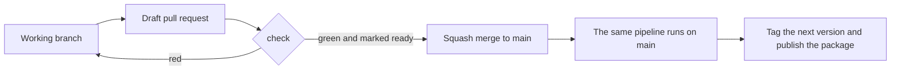

# How platform reaches production

Nothing in this repo reaches production yet. Production is built in phase 3, and this page grows with it. Today it says what leaves this repo and what will, how a change reaches `main`, how the one package is released, and which settings on GitHub protect that path.

## What will leave this repo

| What                                                 | How it will travel                                                                            | State on 2026-11-22                                                                           |
| ---------------------------------------------------- | --------------------------------------------------------------------------------------------- | --------------------------------------------------------------------------------------------- |
| The shared services for the laptop                   | Published to the public npm registry as the package `@zigordev/stack`, by the release below   | The release runs after every merge. The package is still private, so nothing is published yet |
| Changes to AWS, Cloudflare, GitHub and Grafana Cloud | The pipeline shows the plan in the pull request, and applies it after the owner's approval    | Not yet. Phase 3                                                                              |
| The shared services on the host                      | The host runs the same compose files as the laptop                                            | Not yet. Phase 3                                                                              |
| The dashboards and the alert rules                   | The pipeline pushes the same files to Grafana Cloud that the laptop pushes to its own Grafana | Not yet. Phase 3                                                                              |

## The path of a change

The pipeline is not written here. `.github/workflows/ci.yml` calls the one that `toolkit` holds, at one pinned commit, so this repo is checked exactly as every other repo is. It has four jobs. This repo adds one of its own, which starts the shared services for real. One gate passes only when all of them passed:

| Job             | What it checks                                                                                                                 | Runs on                            |
| --------------- | ------------------------------------------------------------------------------------------------------------------------------ | ---------------------------------- |
| Quality         | `pnpm check`, exactly as on a laptop                                                                                           | Every pull request and every merge |
| Title           | The pull request's title is a Conventional Commit                                                                              | Pull requests                      |
| Dependencies    | No dependency the pull request adds has a known flaw                                                                           | Pull requests                      |
| Code scan       | CodeQL finds no vulnerable pattern in our own code or in the workflows                                                         | Every pull request and every merge |
| Shared services | `pnpm local:up` starts all five on GitHub's machine, pushes the dashboards and the alert rules, and each local address answers | Every pull request and every merge |
| `check`         | Every job above passed                                                                                                         | Every pull request and every merge |

A pull request opens as a draft. Marking it ready means: merge it when `check` is green. Nobody merges by hand. A change to infrastructure will be the exception: its plan waits for the owner's approval before anything is applied.

Renovate proposes each new version of the pipeline, as it does for any pinned action.

## The release

One package leaves this repo: `@zigordev/stack`, the shared services for a laptop. A product installs it from the public npm registry and needs no copy of this repo.

After a merge to `main`, and only when `check` is green there, the release runs. It is not written here either: the caller names the release that `toolkit` holds, at the same commit as the pipeline. It has three jobs, and each may do one thing:

| Job     | What it does                                                                                                              | What it may do                                 |
| ------- | ------------------------------------------------------------------------------------------------------------------------- | ---------------------------------------------- |
| Version | Reads the titles merged since the last version, tags the next one and writes the release notes on GitHub                  | Write tags and releases in this repo           |
| Pack    | Runs `pnpm build`, which compiles the command and writes the dashboard and alert files, and packs the package             | Read the repo. It runs the build tools         |
| Publish | Hands the packed file to npm. npm checks with GitHub that this workflow of this repo is the sender, so no token is stored | Ask GitHub for that proof. It installs nothing |

The title of the merged pull request decides the version:

| Title                                                   | Next version                         |
| ------------------------------------------------------- | ------------------------------------ |
| `fix: …` or `perf: …`                                   | A patch, such as 1.4.0 to 1.4.1      |
| `feat: …`                                               | A minor, such as 1.4.1 to 1.5.0      |
| `!` after the type, or a line `BREAKING CHANGE:`        | A major, such as 1.5.0 to 2.0.0      |
| Any other type, such as `docs`, `ci`, `test` or `chore` | None. Nothing is tagged or published |

So a change to the shared services is a `feat` or a `fix`, or no product ever receives it.

A package that is marked `"private": true` is never packed or published, and while the repo has no public package, nothing is tagged. `@zigordev/stack` starts that way. It goes public once the owner has made its first publish, with `pnpm exec zigordev first-publish @zigordev/stack` in this repo's folder, and a pull request has removed the mark within 2 days of it. [Packages](https://github.com/zigordev/toolkit/blob/main/docs/handbook/packages.md), in the handbook, explains why a person makes the first publish.

## The settings on GitHub

They were set by hand when the repo was created, on 2026-11-22, as a copy of the settings of `toolkit`. From phase 3 they are code in this repo.

| Setting                                | Value                                                                                                                 | Why                                                                                                          |
| -------------------------------------- | --------------------------------------------------------------------------------------------------------------------- | ------------------------------------------------------------------------------------------------------------ |
| Visibility                             | Public                                                                                                                | It keeps the pipeline, the code scan and the dependency checks free                                          |
| Merging                                | Squash only, with the pull request's title and description as the commit                                              | One commit per change on `main`, in one format                                                               |
| Branches                               | Deleted after a merge                                                                                                 | No stale branches                                                                                            |
| Ruleset on `main`                      | A pull request is required, `check` is required, no force push, no deletion, linear history, and nobody can bypass it | Nothing reaches `main` unchecked                                                                             |
| Dependency graph and Dependabot alerts | On                                                                                                                    | Dependency Review needs the graph, and the alerts tell the owner about a flaw in a dependency already in use |
| Secret scanning with push protection   | On                                                                                                                    | A push that holds a known kind of secret is refused                                                          |
| The token a workflow gets              | Read-only                                                                                                             | A job asks for each right it needs                                                                           |

## Looking after it

| Situation                                          | What to do                                                                                                                                                                                                                                                                                                                            |
| -------------------------------------------------- | ------------------------------------------------------------------------------------------------------------------------------------------------------------------------------------------------------------------------------------------------------------------------------------------------------------------------------------- |
| `main` is red                                      | Fix it or revert the change before any other work. The run is under Actions, in the workflow named CI                                                                                                                                                                                                                                 |
| A pull request's Quality job is red                | `pnpm check` on the branch shows the same failure                                                                                                                                                                                                                                                                                     |
| Its Title job is red                               | Rewrite the title as `type(scope): summary`, in lower case, with no final period                                                                                                                                                                                                                                                      |
| Its Dependencies job is red                        | The job's summary names the dependency and its flaw. Take a fixed version, or do without it. When another package brings the dependency in and offers no fixed version, name the fixed version under `overrides` in `pnpm-workspace.yaml`                                                                                             |
| Its Code scan job is red                           | The job's log lists each open finding with a link. Fix the code                                                                                                                                                                                                                                                                       |
| Its Shared services job is red                     | The job's log names the container that did not become healthy, or the address that did not answer, and ends with every container's last lines. `pnpm local:up` on a laptop shows the same                                                                                                                                             |
| The Release is red on `main`                       | Read which of its three jobs failed. Version: the titles could not be read, or the tag could not be written. Pack: the build failed. Publish: npm refused, most often because the package is not tied to this repo yet or the tie has expired, which only the owner can renew. The next merge finishes a release that stopped halfway |
| The pipeline does not start at all                 | The caller names a commit of `toolkit` that does not hold the pipeline. Put the commit of a released version back, with its version beside it                                                                                                                                                                                         |
| A pull request from Renovate is red, or stays open | [Dependency updates](https://github.com/zigordev/toolkit/blob/main/docs/handbook/dependency-updates.md), in the handbook, says what each case means                                                                                                                                                                                   |
| A change has to be undone                          | Revert it through a pull request                                                                                                                                                                                                                                                                                                      |

## The one override

`pnpm-workspace.yaml` holds one entry under `overrides`: `katex` 0.19.1.

We do not use `katex`. The Markdown linter brings it in through its extension for maths, which asks for version 0.16. Every version below 0.18.2 has a known flaw of low severity, the advisory GHSA-238p-pmpm-9mq7 of 2026-10-05, and on 2026-11-22 no release of the linter takes a fixed version. The pipeline fails a pull request that adds a dependency with a known flaw, so the first pull request of this repo could not pass.

The override makes pnpm install the fixed version in its place. That is safe here because the linter reads the maths in a file and never renders it, so the code of `katex` does not run. The entry goes when the linter takes a fixed version itself.
