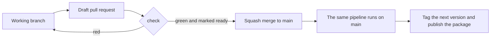

# How platform reaches production

Nothing in this repo reaches production yet. Production is built in phase 3, and this page grows with it. Today it says what leaves this repo and what will, how a change reaches `main`, how the one package is released, and which settings on GitHub protect that path.

## What will leave this repo

| What                                                 | How it will travel                                                                            | State on 2026-11-23                                                                         |
| ---------------------------------------------------- | --------------------------------------------------------------------------------------------- | ------------------------------------------------------------------------------------------- |
| The shared services for the laptop                   | Published to the public npm registry as the package `@zigordev/stack`, by the release below   | Published. The release runs after every merge, and a `feat` or a `fix` gives a new version  |
| Changes to AWS, Cloudflare, GitHub and Grafana Cloud | The pipeline shows the plan in the pull request, and applies it after the owner's approval    | The foundation of the AWS account is written, and waits for its first apply from the laptop |
| The shared services on the host                      | The host runs the same compose files as the laptop                                            | Not yet. Phase 3                                                                            |
| The dashboards and the alert rules                   | The pipeline pushes the same files to Grafana Cloud that the laptop pushes to its own Grafana | Not yet. Phase 3                                                                            |

## The path of a change



The pipeline is not written here. `.github/workflows/ci.yml` calls the one that `toolkit` holds, at one pinned commit, so this repo is checked exactly as every other repo is. It has four jobs. This repo adds three of its own: one starts the shared services for real, and two plan and apply the infrastructure. One gate passes only when all of them passed:

| Job                  | What it checks                                                                                                                                                | Runs on                                                 |
| -------------------- | ------------------------------------------------------------------------------------------------------------------------------------------------------------- | ------------------------------------------------------- |
| Quality              | `pnpm check`, exactly as on a laptop                                                                                                                          | Every pull request and every merge                      |
| Title                | The pull request's title is a Conventional Commit                                                                                                             | Pull requests                                           |
| Dependencies         | No dependency the pull request adds has a known flaw                                                                                                          | Pull requests                                           |
| Code scan            | CodeQL finds no vulnerable pattern in our own code or in the workflows                                                                                        | Every pull request and every merge                      |
| Shared services      | `pnpm local:up` starts all five on GitHub's machine, pushes the dashboards and the alert rules, and each local address answers                                | Every pull request and every merge                      |
| Infrastructure plan  | Signs in to AWS with the read-only role and plans every stack in `infra/`. The plan of each stack shows in the run's summary, which the pull request links to | Every pull request of this repo and every merge         |
| `check`              | Every job above passed                                                                                                                                        | Every pull request and every merge                      |
| Infrastructure apply | Waits for the owner's approval in GitHub, signs in with the apply role, and applies every stack whose plan changed, except the bootstrap                      | A merge whose plan changed a stack the pipeline applies |

Every job names the Ubuntu it runs on, exactly: the gate runs on Ubuntu 26.04, and Shared services on Ubuntu 26.04 for arm64, the kind of machine the server will be. No job uses GitHub's `ubuntu-latest`, which GitHub moves to a new version by itself. A new Ubuntu therefore arrives as a pull request from Renovate, and as a major version it waits a month and for the owner. The jobs that `toolkit` holds follow the same rule.

A pull request opens as a draft. Marking it ready means: merge it when `check` is green. Nobody merges by hand. A change to infrastructure will be the exception: its plan waits for the owner's approval before anything is applied.

Renovate proposes each new version of the pipeline, as it does for any pinned action.

## The release

One package leaves this repo: `@zigordev/stack`, the shared services for a laptop. A product installs it from the public npm registry and needs no copy of this repo.

After a merge to `main`, and only when `check` is green there, the release runs. It is not written here either: the caller names the release that `toolkit` holds, at the same commit as the pipeline. It has three jobs, and each may do one thing:

| Job     | What it does                                                                                                              | What it may do                                 |
| ------- | ------------------------------------------------------------------------------------------------------------------------- | ---------------------------------------------- |
| Version | Reads the titles merged since the last version, tags the next one and writes the release notes on GitHub                  | Write tags and releases in this repo           |
| Pack    | Runs `pnpm build`, which compiles the command and writes the dashboard and alert files, and packs the package             | Read the repo. It runs the build tools         |
| Publish | Hands the packed file to npm. npm checks with GitHub that this workflow of this repo is the sender, so no token is stored | Ask GitHub for that proof. It installs nothing |

The title of the merged pull request decides the version:

| Title                                                   | Next version                         |
| ------------------------------------------------------- | ------------------------------------ |
| `fix: …` or `perf: …`                                   | A patch, such as 1.4.0 to 1.4.1      |
| `feat: …`                                               | A minor, such as 1.4.1 to 1.5.0      |
| `!` after the type, or a line `BREAKING CHANGE:`        | A major, such as 1.5.0 to 2.0.0      |
| Any other type, such as `docs`, `ci`, `test` or `chore` | None. Nothing is tagged or published |

So a change to the shared services is a `feat` or a `fix`, or no product ever receives it.

A package that is marked `"private": true` is never packed or published. Every new package starts that way, and `@zigordev/stack` did too. It went public in two steps. First the owner made its first publish, with `pnpm exec zigordev first-publish @zigordev/stack` in this repo's folder. That command puts an empty version 0.0.0 on npm and ties the name to this repo, to the workflow file `ci.yml` and to the environment `release`. Then a pull request removed the mark, within the 2 days that npm gives a new tie to be used, and since then the release publishes every version, from 1.0.0 on. [Packages](https://github.com/zigordev/toolkit/blob/main/docs/handbook/packages.md), in the handbook, explains why a person makes the first publish.

The version in `stack/package.json` stays `0.0.0` in git. The tag holds the real version, and the Pack job writes it into the file before it packs.

## The foundation of the AWS account

Before any pipeline can change AWS, the account needs a few things that the pipeline itself depends on. They are the stack `infra/bootstrap`, step 3.1 of the build plan.

| What                                          | Why                                                                                                                                                                                                                                              |
| --------------------------------------------- | ------------------------------------------------------------------------------------------------------------------------------------------------------------------------------------------------------------------------------------------------ |
| The bucket `zigordev-platform-opentofu-state` | Holds the OpenTofu state of every stack in this repo. It is private, keeps every earlier version for 90 days, and refuses requests without TLS                                                                                                   |
| The key `alias/platform-opentofu-state`       | Encrypts that state. It rotates by itself, and a deletion waits 30 days                                                                                                                                                                          |
| GitHub's sign-in to AWS                       | Lets a workflow of this repo sign in with a token that GitHub signs, so no AWS key is stored anywhere                                                                                                                                            |
| The role `platform-opentofu-plan`             | Reads AWS for a plan, from a pull request or from `main`. It may write nothing but the state's lock file                                                                                                                                         |
| The role `platform-opentofu-apply`            | Changes AWS, only from a job in the GitHub environment `infrastructure`, from `main`, after the owner approves the run. [Record 0006](adr/0006-the-apply-role-is-an-administrator-behind-the-owners-approval.md) says why it is an administrator |
| The environment `infrastructure`              | The GitHub environment whose approval the apply waits for. Only the owner approves, and only `main` may run in it                                                                                                                                |
| The budget alarm `platform-monthly`           | Emails the owner when the month's forecast passes $30, and again when $30 is spent                                                                                                                                                               |
| The daily spending check                      | AWS's own check for odd spending, which AWS creates with every account. The stack adopts it, and makes it report from $5 of odd spend a day instead of $100                                                                                      |

The address both alarms write to is not in git. The owner stores it once in Parameter Store as `/platform/ALERT_EMAIL`, and the stack reads it from there.

### How it is applied

The bootstrap is applied from the laptop only, never by the pipeline, because it holds the pipeline's own sign-in and the rule that makes it wait. [Record 0005](adr/0005-the-bootstrap-is-applied-from-the-laptop-only.md) says why. A session runs these commands only after the owner has seen the plan and said yes.

The first time, the state bucket does not exist yet, so the state starts on the laptop and moves into the bucket at the end:

```bash
cd infra/bootstrap
aws sso login --profile platform-ops
printf 'terraform {\n  backend "local" {}\n}\n' > backend_override.tf
AWS_PROFILE=platform-ops GITHUB_TOKEN="$(gh auth token)" tofu init -reconfigure
AWS_PROFILE=platform-ops tofu import aws_ce_anomaly_monitor.services "$(aws ce get-anomaly-monitors --profile platform-ops --region us-east-1 --query 'AnomalyMonitors[?MonitorName==`Default-Services-Monitor`].MonitorArn' --output text)"
AWS_PROFILE=platform-ops tofu import aws_ce_anomaly_subscription.daily "$(aws ce get-anomaly-subscriptions --profile platform-ops --region us-east-1 --query 'AnomalySubscriptions[?SubscriptionName==`Default-Services-Subscription`].SubscriptionArn' --output text)"
AWS_PROFILE=platform-ops GITHUB_TOKEN="$(gh auth token)" tofu plan -out=bootstrap.tfplan
AWS_PROFILE=platform-ops GITHUB_TOKEN="$(gh auth token)" tofu apply bootstrap.tfplan
rm backend_override.tf bootstrap.tfplan
AWS_PROFILE=platform-ops GITHUB_TOKEN="$(gh auth token)" tofu init -migrate-state -force-copy
rm terraform.tfstate terraform.tfstate.backup
AWS_PROFILE=platform-ops GITHUB_TOKEN="$(gh auth token)" tofu plan
```

The two imports adopt AWS's own spending check, which may exist only once per account. The last plan must say that nothing changes. The local state files are removed because they hold the alert address in plain text.

Every later change is a pull request whose plan the owner reads, and then, from `main`:

```bash
cd infra/bootstrap
AWS_PROFILE=platform-ops GITHUB_TOKEN="$(gh auth token)" tofu init
AWS_PROFILE=platform-ops GITHUB_TOKEN="$(gh auth token)" tofu plan -out=bootstrap.tfplan
AWS_PROFILE=platform-ops GITHUB_TOKEN="$(gh auth token)" tofu apply bootstrap.tfplan
rm bootstrap.tfplan
```

### What it costs

Measured against AWS's own price list for Ireland on 2026-11-23:

| Part                  | Price                                                                                               |
| --------------------- | --------------------------------------------------------------------------------------------------- |
| The key               | $1 a month. Each yearly rotation adds $1 a month, for the first two rotations only                  |
| The state bucket      | $0.023 per GB a month and $0.005 per 1,000 writes, which for a few small files is well under a cent |
| The budget alarm      | Free: AWS says budgets can be monitored "free of charge"                                            |
| The spending check    | AWS's own default, which its FAQ calls "no effort or cost"                                          |
| Sign-in and the roles | Free                                                                                                |

## How a change reaches AWS

Every stack in `infra/` is code, and every change to it is a pull request. Nothing in AWS, GitHub or another provider is changed by hand. The script `infra/run.sh` does the work in all three places below, so each one plans the same way.

| When                      | What happens                                                                                                                                                                                 | Who acts                                                                                 |
| ------------------------- | -------------------------------------------------------------------------------------------------------------------------------------------------------------------------------------------- | ---------------------------------------------------------------------------------------- |
| A pull request            | The job "Infrastructure plan" signs in with the read-only role and plans every stack. The run's summary holds each plan, with the account number hidden. A plan that fails turns `check` red | Nobody. The owner reads the plan in the summary                                          |
| A merge to `main`         | The plan runs again. When a stack that the pipeline applies has changes, the job "Infrastructure apply" waits in the environment `infrastructure`                                            | The owner approves the run in GitHub: the run's page, then "Review deployments"          |
| The approval              | The job signs in with the apply role, for one hour at most, and applies every changed stack                                                                                                  | Nobody                                                                                   |
| Every Monday at 06:17 UTC | The workflow "Drift" plans every stack, the bootstrap included. When any stack differs from its code, the run fails, and GitHub emails the owner                                             | The owner reads the summary, then undoes the hand-made change or writes it into the code |

The bootstrap is the one stack the pipeline never applies: [record 0005](adr/0005-the-bootstrap-is-applied-from-the-laptop-only.md) says why. Its plan still shows on every pull request, and its summary says to apply it from the laptop.

The pipeline finds the roles by their full name, which holds the account number. The number is not in git: the owner set it once as the repository variable `AWS_ACCOUNT_ID`, and the sign-in hides it in the logs. [Record 0007](adr/0007-the-aws-account-number-lives-in-a-github-variable.md) says why.

## The settings on GitHub

They were set by hand when the repo was created, on 2026-11-22, as a copy of the settings of `toolkit`. From phase 3 they are code in this repo.

| Setting                                | Value                                                                                                                 | Why                                                                                                          |
| -------------------------------------- | --------------------------------------------------------------------------------------------------------------------- | ------------------------------------------------------------------------------------------------------------ |
| Visibility                             | Public                                                                                                                | It keeps the pipeline, the code scan and the dependency checks free                                          |
| Merging                                | Squash only, with the pull request's title and description as the commit                                              | One commit per change on `main`, in one format                                                               |
| Branches                               | Deleted after a merge                                                                                                 | No stale branches                                                                                            |
| Ruleset on `main`                      | A pull request is required, `check` is required, no force push, no deletion, linear history, and nobody can bypass it | Nothing reaches `main` unchecked                                                                             |
| Dependency graph and Dependabot alerts | On                                                                                                                    | Dependency Review needs the graph, and the alerts tell the owner about a flaw in a dependency already in use |
| Secret scanning with push protection   | On                                                                                                                    | A push that holds a known kind of secret is refused                                                          |
| The token a workflow gets              | Read-only                                                                                                             | A job asks for each right it needs                                                                           |
| The variable `AWS_ACCOUNT_ID`          | The AWS account's number, set by the owner                                                                            | The pipeline builds the roles' names from it, and the number stays out of the public repo                    |
| The environment `infrastructure`       | Only the owner approves, administrators cannot skip it, and only `main` may run in it. The bootstrap creates it       | Every apply waits for the owner                                                                              |

## Looking after it

| Situation                                          | What to do                                                                                                                                                                                                                                                                                                                            |
| -------------------------------------------------- | ------------------------------------------------------------------------------------------------------------------------------------------------------------------------------------------------------------------------------------------------------------------------------------------------------------------------------------- |
| `main` is red                                      | Fix it or revert the change before any other work. The run is under Actions, in the workflow named CI                                                                                                                                                                                                                                 |
| A pull request's Quality job is red                | `pnpm check` on the branch shows the same failure                                                                                                                                                                                                                                                                                     |
| Its Title job is red                               | Rewrite the title as `type(scope): summary`, in lower case, with no final period                                                                                                                                                                                                                                                      |
| Its Dependencies job is red                        | The job's summary names the dependency and its flaw. Take a fixed version, or do without it. When another package brings the dependency in and offers no fixed version, name the fixed version under `overrides` in `pnpm-workspace.yaml`                                                                                             |
| Its Code scan job is red                           | The job's log lists each open finding with a link. Fix the code                                                                                                                                                                                                                                                                       |
| Its Shared services job is red                     | The job's log names the container that did not become healthy, or the address that did not answer, and ends with every container's last lines. `pnpm local:up` on a laptop shows the same                                                                                                                                             |
| The Release is red on `main`                       | Read which of its three jobs failed. Version: the titles could not be read, or the tag could not be written. Pack: the build failed. Publish: npm refused, most often because the package is not tied to this repo yet or the tie has expired, which only the owner can renew. The next merge finishes a release that stopped halfway |
| The pipeline does not start at all                 | The caller names a commit of `toolkit` that does not hold the pipeline. Put the commit of a released version back, with its version beside it                                                                                                                                                                                         |
| A pull request from Renovate is red, or stays open | [Dependency updates](https://github.com/zigordev/toolkit/blob/main/docs/handbook/dependency-updates.md), in the handbook, says what each case means                                                                                                                                                                                   |
| Its Infrastructure plan job is red                 | The summary shows the failing stack. A sign-in that is refused means the variable `AWS_ACCOUNT_ID` is missing, or a role's trust does not name this repo in GitHub's form                                                                                                                                                             |
| A merge waits on "Infrastructure apply"            | It waits for the owner. Open the run, read the plan in the summary of "Infrastructure plan", then "Review deployments"                                                                                                                                                                                                                |
| The Drift run failed                               | Something in AWS, GitHub or another provider was changed outside the code. The summary names the stack and the change. Undo it, or write it into the code                                                                                                                                                                             |
| A change has to be undone                          | Revert it through a pull request                                                                                                                                                                                                                                                                                                      |

## The one override

`pnpm-workspace.yaml` holds one entry under `overrides`: `katex` 0.19.1.

We do not use `katex`. The Markdown linter brings it in through its extension for maths, which asks for version 0.16. Every version below 0.18.2 has a known flaw of low severity, the advisory GHSA-238p-pmpm-9mq7 of 2026-10-05, and on 2026-11-22 no release of the linter takes a fixed version. The pipeline fails a pull request that adds a dependency with a known flaw, so the first pull request of this repo could not pass.

The override makes pnpm install the fixed version in its place. That is safe here because the linter reads the maths in a file and never renders it, so the code of `katex` does not run. The entry goes when the linter takes a fixed version itself.
