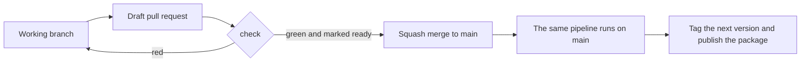
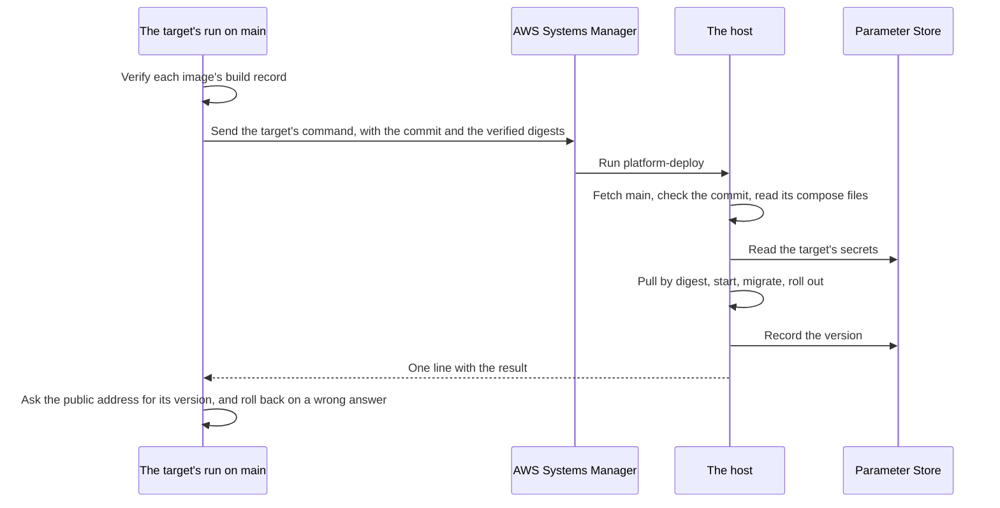

# How platform reaches production

Production is built in phase 3, and this page grows with it. Today it says what leaves this repo and what will, how a change reaches `main`, how the one package is released, which settings on GitHub protect that path, how the one server is built and reached, and how a deploy reaches it.

## What will leave this repo

| What                                                 | How it will travel                                                                                                                                                        | State on 2026-11-23                                                                        |
| ---------------------------------------------------- | ------------------------------------------------------------------------------------------------------------------------------------------------------------------------- | ------------------------------------------------------------------------------------------ |
| The shared services for the laptop                   | Published to the public npm registry as the package `@zigordev/stack`, by the release below                                                                               | Published. The release runs after every merge, and a `feat` or a `fix` gives a new version |
| Changes to AWS, Cloudflare, GitHub and Grafana Cloud | The pipeline shows the plan in the pull request, and applies it after the owner's approval                                                                                | Running since 2026-11-23: the bootstrap, the plan and the apply, and GitHub's settings     |
| The host itself                                      | The stack `infra/host`, with the files under `host/root` as its user data                                                                                                 | Written in step 3.4. It exists once the owner has approved its first apply                 |
| The shared services on the host                      | Through the deploy path below: every merge to `main` runs the job "Deploy the shared services", which sends the command `platform-deploy-platform`                        | From step 3.7. The job deploys `stack/compose.yaml` with `stack/compose.production.yaml`   |
| The dashboards and the alert rules                   | The pipeline pushes the same files to Grafana Cloud that the laptop pushes to its own Grafana                                                                             | Written in step 3.6, and switched on in step 3.7, on 2026-11-24, once the agent sent data  |
| The backups                                          | The stack `infra/backups`: the bucket for the dumps, its key and lock, and the daily snapshot of the data disk. The host dumps every hour and tests a restore every month | Written in step 3.8 on 2026-11-25. It exists once the owner has approved its apply         |

## The path of a change



The pipeline is not written here. `.github/workflows/ci.yml` calls the one that `toolkit` holds, at one pinned commit, so this repo is checked exactly as every other repo is. It has four jobs. This repo adds three of its own: one starts the shared services for real, and two plan and apply the infrastructure. One gate passes only when all of them passed:

| Job                        | What it checks                                                                                                                                                                                         | Runs on                                                           |
| -------------------------- | ------------------------------------------------------------------------------------------------------------------------------------------------------------------------------------------------------ | ----------------------------------------------------------------- |
| Quality                    | `pnpm check`, exactly as on a laptop                                                                                                                                                                   | Every pull request and every merge                                |
| Title                      | The pull request's title is a Conventional Commit                                                                                                                                                      | Pull requests                                                     |
| Dependencies               | No dependency the pull request adds has a known flaw                                                                                                                                                   | Pull requests                                                     |
| Code scan                  | CodeQL finds no vulnerable pattern in our own code or in the workflows                                                                                                                                 | Every pull request and every merge                                |
| Shared services            | `pnpm local:up` starts all six on GitHub's machine, pushes the dashboards and the alert rules, and each local address answers                                                                          | Every pull request and every merge                                |
| Infrastructure plan        | Signs in to AWS with the read-only role and plans every stack in `infra/`. The plan of each stack shows in the run's summary, which the pull request links to                                          | Every pull request of this repo and every merge                   |
| `check`                    | Every job above passed                                                                                                                                                                                 | Every pull request and every merge                                |
| Infrastructure apply       | Waits for the owner's approval in GitHub, signs in with the apply role, and applies every stack whose plan changed, except the bootstrap                                                               | A merge whose plan changed a stack the pipeline applies           |
| Observability changes      | Decides whether the dashboards and the alert rules go to Grafana Cloud: only when the switch in `observability/push.json` is on and the files that gcx pushes differ from those of the commit before   | Every merge                                                       |
| Observability push         | Waits for the owner's approval, signs in with the apply role, builds the files, waits for the stack to answer, pushes them with gcx and deletes what the files no longer hold in the folder `zigordev` | A merge that the job above lets through                           |
| Deploy the shared services | Runs the deploy workflow of `toolkit` for the target `platform`: the host runs the shared services at the merged commit, and the run ends with the host's result                                       | A merge, after the gate, and after the apply when a stack changed |

Every job names the Ubuntu it runs on, exactly: the gate runs on Ubuntu 26.04, and Shared services on Ubuntu 26.04 for arm64, the kind of machine the server will be. No job uses GitHub's `ubuntu-latest`, which GitHub moves to a new version by itself. A new Ubuntu therefore arrives as a pull request from Renovate, and as a major version it waits a month and for the owner. The jobs that `toolkit` holds follow the same rule.

A pull request opens as a draft. Marking it ready means: merge it when `check` is green. Nobody merges by hand. A change to infrastructure will be the exception: its plan waits for the owner's approval before anything is applied.

Renovate proposes each new version of the pipeline, as it does for any pinned action.

## The release

One package leaves this repo: `@zigordev/stack`, the shared services for a laptop. A product installs it from the public npm registry and needs no copy of this repo.

After a merge to `main`, and only when `check` is green there, the release runs. It is not written here either: the caller names the release that `toolkit` holds, at the same commit as the pipeline. It has three jobs, and each may do one thing:

| Job     | What it does                                                                                                              | What it may do                                 |
| ------- | ------------------------------------------------------------------------------------------------------------------------- | ---------------------------------------------- |
| Version | Reads the titles merged since the last version, tags the next one and writes the release notes on GitHub                  | Write tags and releases in this repo           |
| Pack    | Runs `pnpm build`, which compiles the command and writes the dashboard and alert files, and packs the package             | Read the repo. It runs the build tools         |
| Publish | Hands the packed file to npm. npm checks with GitHub that this workflow of this repo is the sender, so no token is stored | Ask GitHub for that proof. It installs nothing |

The title of the merged pull request decides the version:

| Title                                                   | Next version                         |
| ------------------------------------------------------- | ------------------------------------ |
| `fix: …` or `perf: …`                                   | A patch, such as 1.4.0 to 1.4.1      |
| `feat: …`                                               | A minor, such as 1.4.1 to 1.5.0      |
| `!` after the type, or a line `BREAKING CHANGE:`        | A major, such as 1.5.0 to 2.0.0      |
| Any other type, such as `docs`, `ci`, `test` or `chore` | None. Nothing is tagged or published |

So a change to the shared services is a `feat` or a `fix`, or no product ever receives it.

A package that is marked `"private": true` is never packed or published. Every new package starts that way, and `@zigordev/stack` did too. It went public in two steps. First the owner made its first publish, with `pnpm exec zigordev first-publish @zigordev/stack` in this repo's folder. That command puts an empty version 0.0.0 on npm and ties the name to this repo, to the workflow file `ci.yml` and to the environment `release`. Then a pull request removed the mark, within the 2 days that npm gives a new tie to be used, and since then the release publishes every version, from 1.0.0 on. [Packages](https://github.com/zigordev/toolkit/blob/main/docs/handbook/packages.md), in the handbook, explains why a person makes the first publish.

The version in `stack/package.json` stays `0.0.0` in git. The tag holds the real version, and the Pack job writes it into the file before it packs.

## The foundation of the AWS account

Before any pipeline can change AWS, the account needs a few things that the pipeline itself depends on. They are the stack `infra/bootstrap`, step 3.1 of the build plan.

| What                                          | Why                                                                                                                                                                                                                                              |
| --------------------------------------------- | ------------------------------------------------------------------------------------------------------------------------------------------------------------------------------------------------------------------------------------------------ |
| The bucket `zigordev-platform-opentofu-state` | Holds the OpenTofu state of every stack in this repo. It is private, keeps every earlier version for 90 days, and refuses requests without TLS                                                                                                   |
| The key `alias/platform-opentofu-state`       | Encrypts that state. It rotates by itself, and a deletion waits 30 days                                                                                                                                                                          |
| GitHub's sign-in to AWS                       | Lets a workflow of this repo sign in with a token that GitHub signs, so no AWS key is stored anywhere                                                                                                                                            |
| The role `platform-opentofu-plan`             | Reads AWS for a plan, from a pull request or from `main`. It may write only the state's lock file, and plans no longer take that lock: [record 0022](adr/0022-plans-read-the-state-without-locking-it.md) says why                               |
| The role `platform-opentofu-apply`            | Changes AWS, only from a job in the GitHub environment `infrastructure`, from `main`, after the owner approves the run. [Record 0006](adr/0006-the-apply-role-is-an-administrator-behind-the-owners-approval.md) says why it is an administrator |
| The environment `infrastructure`              | The GitHub environment whose approval the apply waits for. Only the owner approves, and only `main` may run in it                                                                                                                                |
| The budget alarm `platform-monthly`           | Emails the owner when the month's forecast passes $30, and again when $30 is spent                                                                                                                                                               |
| The daily spending check                      | AWS's own check for odd spending, which AWS creates with every account. The stack adopts it, and makes it report from $5 of odd spend a day instead of $100                                                                                      |

The address both alarms write to is not in git. The owner stores it once in Parameter Store as `/platform/ALERT_EMAIL`, and the stack reads it from there.

### How it is applied

The bootstrap is applied from the laptop only, never by the pipeline, because it holds the pipeline's own sign-in and the rule that makes it wait. [Record 0005](adr/0005-the-bootstrap-is-applied-from-the-laptop-only.md) says why. A session runs these commands only after the owner has seen the plan and said yes.

The first time, the state bucket does not exist yet, so the state starts on the laptop and moves into the bucket at the end:

```bash
cd infra/bootstrap
aws sso login --profile platform-ops
printf 'terraform {\n  backend "local" {}\n}\n' > backend_override.tf
AWS_PROFILE=platform-ops GITHUB_TOKEN="$(gh auth token)" tofu init -reconfigure
AWS_PROFILE=platform-ops tofu import aws_ce_anomaly_monitor.services "$(aws ce get-anomaly-monitors --profile platform-ops --region us-east-1 --query 'AnomalyMonitors[?MonitorName==`Default-Services-Monitor`].MonitorArn' --output text)"
AWS_PROFILE=platform-ops tofu import aws_ce_anomaly_subscription.daily "$(aws ce get-anomaly-subscriptions --profile platform-ops --region us-east-1 --query 'AnomalySubscriptions[?SubscriptionName==`Default-Services-Subscription`].SubscriptionArn' --output text)"
AWS_PROFILE=platform-ops GITHUB_TOKEN="$(gh auth token)" tofu plan -out=bootstrap.tfplan
AWS_PROFILE=platform-ops GITHUB_TOKEN="$(gh auth token)" tofu apply bootstrap.tfplan
rm backend_override.tf bootstrap.tfplan
AWS_PROFILE=platform-ops GITHUB_TOKEN="$(gh auth token)" tofu init -migrate-state -force-copy
rm terraform.tfstate terraform.tfstate.backup
AWS_PROFILE=platform-ops GITHUB_TOKEN="$(gh auth token)" tofu plan
```

The two imports adopt AWS's own spending check, which may exist only once per account. The last plan must say that nothing changes. The local state files are removed because they hold the alert address in plain text.

Every later change is a pull request whose plan the owner reads, and then, from `main`:

```bash
cd infra/bootstrap
AWS_PROFILE=platform-ops GITHUB_TOKEN="$(gh auth token)" tofu init
AWS_PROFILE=platform-ops GITHUB_TOKEN="$(gh auth token)" tofu plan -out=bootstrap.tfplan
AWS_PROFILE=platform-ops GITHUB_TOKEN="$(gh auth token)" tofu apply bootstrap.tfplan
rm bootstrap.tfplan
```

### What it costs

Measured against AWS's own price list for Ireland on 2026-11-23:

| Part                  | Price                                                                                               |
| --------------------- | --------------------------------------------------------------------------------------------------- |
| The key               | $1 a month. Each yearly rotation adds $1 a month, for the first two rotations only                  |
| The state bucket      | $0.023 per GB a month and $0.005 per 1,000 writes, which for a few small files is well under a cent |
| The budget alarm      | Free: AWS says budgets can be monitored "free of charge"                                            |
| The spending check    | AWS's own default, which its FAQ calls "no effort or cost"                                          |
| Sign-in and the roles | Free                                                                                                |

## How a change reaches AWS

Every stack in `infra/` is code, and every change to it is a pull request. Nothing in AWS, GitHub or another provider is changed by hand. The script `infra/run.sh` does the work in all three places below, so each one plans the same way.

| When                      | What happens                                                                                                                                                                                 | Who acts                                                                                 |
| ------------------------- | -------------------------------------------------------------------------------------------------------------------------------------------------------------------------------------------- | ---------------------------------------------------------------------------------------- |
| A pull request            | The job "Infrastructure plan" signs in with the read-only role and plans every stack. The run's summary holds each plan, with the account number hidden. A plan that fails turns `check` red | Nobody. The owner reads the plan in the summary                                          |
| A merge to `main`         | The plan runs again. When a stack that the pipeline applies has changes, the job "Infrastructure apply" waits in the environment `infrastructure`                                            | The owner approves the run in GitHub: the run's page, then "Review deployments"          |
| The approval              | The job signs in with the apply role, for one hour at most, and applies every changed stack                                                                                                  | Nobody                                                                                   |
| Every Monday at 06:17 UTC | The workflow "Drift" plans every stack, the bootstrap included. When any stack differs from its code, the run fails, and GitHub emails the owner                                             | The owner reads the summary, then undoes the hand-made change or writes it into the code |

Runs on `main` go one at a time: the workflow's concurrency group holds a later run until the earlier one ends. So a run that waits for the owner's approval holds back every later merge. Only one run waits behind it: a newer merge replaces the older run that has not started yet, and the newer run's plan holds both changes, because its commit holds both.

GitHub can lose an approval request. On 2026-11-24 the job "Infrastructure apply" showed "Starting job" for 15 minutes, with no machine and nothing to approve. Re-running its cancelled job on 2026-11-25 did not help: GitHub cancelled the re-run in the same second it started. Cancel such a run on its page, then merge the next change. Its new run plans the same changes again and asks for the approval anew. The workflow has no manual start, so when nothing else is ready to merge, a small fix to the docs is that change.

The bootstrap is the one stack the pipeline never applies: [record 0005](adr/0005-the-bootstrap-is-applied-from-the-laptop-only.md) says why. Its plan still shows on every pull request, and its summary says to apply it from the laptop.

The pipeline finds the roles by their full name, which holds the account number. The number is in neither git nor the logs: the owner set it once as the repository secret `AWS_ACCOUNT_ID`, and GitHub hides a secret in every log line. [Record 0007](adr/0007-the-aws-account-number-lives-in-a-github-secret.md) says why.

The stack `infra/github` signs in to GitHub as a GitHub App that the owner made for it, because the token GitHub gives each workflow cannot even read most settings. The app holds three rights, each read and write: Administration, Issues and Variables. Its private key is the SecureString `/platform/GITHUB_APP_PRIVATE_KEY` in Parameter Store, which only the owner stores, and each run gets a token that lasts one hour. [Record 0008](adr/0008-the-pipeline-changes-github-through-one-github-app.md) says why.

## The host

One server runs every product: the host. It is step 3.4 of the build plan, the stack `infra/host`, and nothing on it is made by hand.

### What it is

| Part               | What it is                                                                                                                                                                                                                                                                                                                                                 |
| ------------------ | ---------------------------------------------------------------------------------------------------------------------------------------------------------------------------------------------------------------------------------------------------------------------------------------------------------------------------------------------------------- |
| The network        | Its own network, `platform` (10.20.0.0/16), with one subnet in `eu-west-1a` and a way out to the internet. The network's default security group holds no rule                                                                                                                                                                                              |
| The security group | `platform-host`. It lets nothing in, and lets the host reach out to anywhere, for updates, images and AWS's own services                                                                                                                                                                                                                                   |
| The server         | `platform-host`, a t4g.medium: 2 Arm processors and 4 GiB of memory, since the Kafka broker arrived, as [toolkit's record 0043](https://github.com/zigordev/toolkit/blob/main/docs/adr/0043-the-host-steps-up-to-a-t4g-medium-when-the-broker-arrives.md) says. Its processor credits are capped, so a runaway process slows down instead of costing money |
| The image          | Canonical's Ubuntu 26.04 LTS for Arm, the newest one when the host is built                                                                                                                                                                                                                                                                                |
| The system disk    | 20 GB of encrypted gp3. It holds Ubuntu, Docker and the images, and goes with the server                                                                                                                                                                                                                                                                   |
| The data disk      | `platform-data`: 10 GB of encrypted gp3, mounted at `/srv/data`. Every Docker volume lives on it. It outlives the server, and the code refuses to delete it                                                                                                                                                                                                |
| The role           | `platform-host`. It lets AWS Systems Manager reach the host. `infra/deploy` lets it read the secrets that each deploy names and keep the deploy records, and nothing else. [Record 0011](adr/0011-the-only-way-into-the-host-is-aws-systems-manager.md) says why                                                                                           |

### What runs on it

Everything below comes from `host/root`, where each file sits at its path on the host. At the first boot, cloud-init writes them all and runs `/usr/local/sbin/platform-setup` once.

| What                       | How                                                                                                                                                                                                                                                                                                                                                                                   |
| -------------------------- | ------------------------------------------------------------------------------------------------------------------------------------------------------------------------------------------------------------------------------------------------------------------------------------------------------------------------------------------------------------------------------------- |
| Docker and Docker Compose  | From Docker's own repository, held to Docker 29, containerd 2 and Compose 5. Logs rotate at 10 MB, five files per container, and containers keep running while Docker updates itself. [Record 0010](adr/0010-docker-on-the-host-comes-from-dockers-own-repository.md) says why                                                                                                        |
| Automatic updates          | Every day, Ubuntu's security updates and Docker's updates install themselves. When one needs a restart, the host restarts at 03:00 UTC. [Record 0012](adr/0012-the-host-restarts-itself-at-night-when-an-update-needs-it.md) says why                                                                                                                                                 |
| The data disk              | `platform-data-disk.service` waits up to 15 minutes for the disk. A disk on which blkid finds no file system and no other signature is new, and gets an ext4 file system labelled `platform-data`. A disk with a signature is used as it is, and one that blkid cannot read is left untouched. Docker does not start until the disk is mounted                                        |
| The Docker cleanup         | `platform-docker-cleanup.timer`, every day at 04:30 UTC: it removes stopped containers, unused networks and unused images older than 7 days. It never touches a volume                                                                                                                                                                                                                |
| Each container's memory    | `platform-container-memory.timer`, every minute: it writes each container's memory and its limit to `/var/lib/platform/metrics/containers.prom`, with the labels the logs carry. Alloy reads that file once it runs on the host                                                                                                                                                       |
| The way in                 | AWS Systems Manager only. The SSH server is switched off, and there is no key                                                                                                                                                                                                                                                                                                         |
| The repair of a first boot | The association `platform-host-repair-first-boot` in AWS Systems Manager runs `host/repair-first-boot` on the host every 30 minutes, and as soon as a new host reports to it. When cloud-init found no setup, it clears cloud-init and restarts the host, at most 3 times. [Record 0013](adr/0013-a-first-boot-that-misses-its-setup-is-repaired-through-systems-manager.md) says why |
| The deploy script          | `/usr/local/sbin/platform-deploy`, which each deploy command runs. "Deploys" below says what it does                                                                                                                                                                                                                                                                                  |
| The bring-back at boot     | `platform-redeploy.service`, at every boot once Docker runs. It brings back every recorded deploy that has no container on the host                                                                                                                                                                                                                                                   |
| The tools of a deploy      | git and jq from Ubuntu, the AWS CLI from AWS's snap (track v2/stable), which updates itself, and docker-rollout v0.14 at one commit, checked against its hash                                                                                                                                                                                                                         |

### How to open a shell

Two ways, both through your AWS sign-in:

- **In the browser:** the AWS console in Ireland, then EC2, then Instances, then `platform-host`, then Connect, then the tab Session Manager, then Connect.
- **From the laptop**, with AWS's Session Manager plugin installed (`brew install --cask session-manager-plugin`):

```bash
aws sso login --profile platform-ops
aws ssm start-session --profile platform-ops --region eu-west-1 --target "$(aws ec2 describe-instances --profile platform-ops --region eu-west-1 --filters Name=tag:Name,Values=platform-host Name=instance-state-name,Values=running --query 'Reservations[0].Instances[0].InstanceId' --output text)"
```

The shell runs as `ssm-user`, which may use `sudo`. These commands show the host's state:

| Command                                          | What it shows                                                                                    |
| ------------------------------------------------ | ------------------------------------------------------------------------------------------------ |
| `cloud-init status --long`                       | Whether the first boot finished, and the error if not                                            |
| `cat /var/lib/cloud/data/instance-id`            | The host's own id when the first boot found its setup, and `iid-datasource-none` when it did not |
| `cat /var/lib/platform-repair/restarts`          | How often the repair restarted the first boot                                                    |
| `sudo tail -n 50 /var/log/cloud-init-output.log` | What the setup script printed                                                                    |
| `findmnt /srv/data /var/lib/docker/volumes`      | That the data disk is mounted, and Docker's volumes on it                                        |
| `systemctl list-timers 'platform-*'`             | When each timer last ran and runs next                                                           |
| `cat /etc/platform/generation`                   | Which generation of the host runs                                                                |
| `cat /var/lib/platform/metrics/containers.prom`  | Each container's memory and limit, a minute old at most                                          |
| `sudo unattended-upgrade --dry-run`              | Which updates are waiting                                                                        |
| `cat /var/run/reboot-required 2> /dev/null`      | Whether an update waits for the night's restart                                                  |

### How a change reaches it

A change to any file under `host/root`, or to the user data, rebuilds the host. The plan says that the instance "must be replaced". After the owner's approval, the old host stops, which stops every container cleanly, the data disk moves to the new host, and the new host runs its first boot again, which takes a few minutes. [Record 0009](adr/0009-the-host-is-built-at-its-first-boot-and-rebuilt-on-a-change.md) says why.

To rebuild the host on purpose, for example when it misbehaves and a restart does not help, raise the number in `host/root/etc/platform/generation` through a pull request. Nothing reads the number: it changes the user data, and that rebuilds the host. On the host, `cat /etc/platform/generation` tells which generation runs. [Record 0023](adr/0023-the-host-is-rebuilt-on-purpose-by-raising-its-generation.md) says why.

A new size, in `instance_type` in `infra/host/locals.tf`, does not rebuild the host. The plan says the instance is "updated in-place". After the owner's approval, AWS stops the host, which stops every container cleanly, changes its size and starts it again. Both disks stay as they are, the containers come back by themselves, and the products are away for a few minutes. The host also gets a new public address, which nothing depends on, because the host opens no port. [Toolkit's record 0043](https://github.com/zigordev/toolkit/blob/main/docs/adr/0043-the-host-steps-up-to-a-t4g-medium-when-the-broker-arrives.md) says when the size steps up.

A new host's first boot often misses its setup. Ubuntu's cloud images start without their boot image, so the network driver loads from the new disk, and AWS copies a new disk's blocks from storage on their first read. On 2026-11-23 the driver arrived 3 seconds after cloud-init looked for a network card, and cloud-init went on with no setup. Within minutes the repair restarts the first boot, which then finds its setup, so a rebuild takes about 15 minutes instead of 5.

A new encrypted AWS disk does not read as zeros. On 2026-11-24 the new data disk read as random bytes everywhere after its first 4 KB, so only its missing signature tells that it is new, as AWS's own guide to a new volume says.

cloud-init receives the files compressed. On 2026-11-24 they took 35 KB, and 12 KB compressed, of the 16 KB of user data that EC2 takes. A change to the deploy script rebuilds the host too.

A newer Ubuntu image does not rebuild the host, because the automatic updates keep it current. The next rebuild takes the newest image.

### What the host costs

Measured against AWS's own price list for Ireland on 2026-11-23, and for the server on 2026-11-25, for a month of 730 hours:

| Part               | Price                                                                                                                                | A month |
| ------------------ | ------------------------------------------------------------------------------------------------------------------------------------ | ------- |
| The server         | $0.0368 an hour for a t4g.medium. AWS's free trial until 2026-12-31 covers only the t4g.small, so it does not apply                  | $26.86  |
| The system disk    | 20 GB at $0.088 per GB a month                                                                                                       | $1.76   |
| The data disk      | 10 GB at $0.088 per GB a month                                                                                                       | $0.88   |
| The public address | $0.005 an hour. The host needs one to reach GitHub, its image registry and Systems Manager, which have no IPv6 address on 2026-11-23 | $3.65   |
| Systems Manager    | AWS: "No additional charges for usage on Amazon EC2 instances"                                                                       | $0      |

So the host costs $33.15 a month. As a t4g.small it cost $6.29 a month during the free trial, and $19.72 after it: the step to 4 GiB adds $13.43 a month at list price. The capped credits rule out a charge for surplus processor credits.

## Cloudflare

`zigordev.com` lives on Cloudflare's free plan, and the stack `infra/cloudflare` holds all of it. It is step 3.5 of the build plan, and [record 0014](adr/0014-cloudflare-holds-one-record-per-product-and-the-https-settings.md) says why it is shaped this way.

### What it holds

| Part                       | What it is                                                                                                                                                                                                                                      |
| -------------------------- | ----------------------------------------------------------------------------------------------------------------------------------------------------------------------------------------------------------------------------------------------- |
| The tunnel `platform-host` | A connection that the host opens to Cloudflare, so visitors reach the host with no port open. Cloudflare holds its configuration: one route sends every `*.zigordev.com` name to Traefik at `http://traefik:8080`, and anything else gets a 404 |
| One record per product     | `<product>.zigordev.com`, a proxied CNAME to the tunnel, made from the product list `infra/products.json`. It holds `playground`, the test app of step 3.9                                                                                      |
| The mail records           | SPF `v=spf1 -all` names no sender, and DMARC `p=reject; sp=reject` asks every receiver to reject mail that claims the domain. They change when SES sends, in phase 5                                                                            |
| The HTTPS settings         | Always Use HTTPS, automatic HTTPS rewrites, and TLS 1.2 at least                                                                                                                                                                                |

### The two tokens

Both are SecureStrings in Parameter Store, and only the owner stores them, with a command that shows nothing.

| Token                | Name                                | What it is                                                                                                                                                                                                |
| -------------------- | ----------------------------------- | --------------------------------------------------------------------------------------------------------------------------------------------------------------------------------------------------------- |
| The Cloudflare token | `/platform/CLOUDFLARE_API_TOKEN`    | An account API token with four permissions: Cloudflare One Connector: cloudflared, Edit, on the account, and DNS, Edit, Zone, Read and Zone Settings, Edit, on `zigordev.com`. The stack signs in with it |
| The tunnel's token   | `/platform/CLOUDFLARE_TUNNEL_TOKEN` | What `cloudflared` on the host signs in with, from step 3.7. The code never reads it. [Record 0015](adr/0015-the-owner-stores-the-tunnels-token.md) says why                                              |

To store a token, copy it in Cloudflare's dashboard, then run this on the laptop with that token's name. It waits silently for the paste and Enter:

```bash
read -rs TOKEN && aws ssm put-parameter --profile platform-ops --region eu-west-1 --name /platform/CLOUDFLARE_TUNNEL_TOKEN --type SecureString --overwrite --value "$TOKEN"; unset TOKEN
```

The tunnel's token is in the dashboard under Zero Trust, then Networks: open the tunnel `platform-host`, and copy the token from the install command that its connector page shows.

### How a product gets its address

Once the owner has said yes to a product, its address is one entry in `infra/products.json`. The plan shows one new record, and the tunnel needs no change, because Traefik routes the name by the labels that the product's containers carry.

### How to check it

| Command                                    | What it shows                                                               |
| ------------------------------------------ | --------------------------------------------------------------------------- |
| `dig +short NS zigordev.com`               | Cloudflare's two name servers                                               |
| `dig +short playground.zigordev.com`       | Cloudflare's addresses: the test app's address resolves                     |
| `dig +short TXT zigordev.com`              | The SPF record                                                              |
| `dig +short TXT _dmarc.zigordev.com`       | The DMARC record                                                            |
| `curl -sI http://playground.zigordev.com`  | A redirect to `https://`                                                    |
| `curl -sI https://playground.zigordev.com` | Cloudflare's error 1033 until `cloudflared` runs on the host, from step 3.7 |

### What Cloudflare costs

Nothing. The free plan holds the DNS, the proxy with its certificate, the tunnel and these settings. Cloudflare's docs list tunnels as "Available on all plans".

## Grafana Cloud

Production's telemetry goes to Grafana Cloud, on its free plan, in the stack `merryantelope975` in Ireland. It is step 3.6 of the build plan, in two stacks: `infra/grafana-cloud` makes the access, and `infra/grafana` fills the stack itself.

### The access

`infra/grafana-cloud` signs in with the owner's token, `/platform/GRAFANA_CLOUD_TOKEN`, and makes every other credential from it. [Record 0016](adr/0016-the-code-makes-grafanas-tokens-from-the-owners-one-token.md) says why.

| Parameter                                                                                                                                                                                                                      | What it holds                                                              | What reads it                                                               |
| ------------------------------------------------------------------------------------------------------------------------------------------------------------------------------------------------------------------------------ | -------------------------------------------------------------------------- | --------------------------------------------------------------------------- |
| `/platform/GRAFANA_STACK_TOKEN`                                                                                                                                                                                                | The token of the stack account `platform-opentofu`, an Admin of this stack | The stack `infra/grafana`, and the pipeline's push of dashboards and alerts |
| `/platform/GRAFANA_ALLOY_TOKEN`                                                                                                                                                                                                | A token that only writes metrics, logs and traces                          | The telemetry agent on the host, from step 3.7                              |
| `/platform/GRAFANA_READ_TOKEN`                                                                                                                                                                                                 | A token that only reads them                                               | The data sources `prometheus`, `loki` and `tempo`                           |
| `/platform/GRAFANA_CHECKS_TOKEN`                                                                                                                                                                                               | The outside checks' own token                                              | The stack `infra/grafana`                                                   |
| `/platform/GRAFANA_URL`, `GRAFANA_STACK_ID`, `GRAFANA_OTLP_URL`, `GRAFANA_LOKI_URL`, `GRAFANA_LOKI_USER`, `GRAFANA_PROMETHEUS_URL`, `GRAFANA_PROMETHEUS_USER`, `GRAFANA_TEMPO_URL`, `GRAFANA_TEMPO_USER`, `GRAFANA_CHECKS_URL` | The stack's addresses and ids, as plain strings                            | The host and the stack `infra/grafana`                                      |

Every token covers this one stack. The stack's numeric id works like an account number, so the code marks it sensitive, and the pipeline plans with `-concise`: no Grafana id reaches the public run summary.

### The stack

`infra/grafana` signs in as the stack account `platform-opentofu` and fills the stack.

| Part                                              | What it is                                                                                                                                                                                                                                                                  |
| ------------------------------------------------- | --------------------------------------------------------------------------------------------------------------------------------------------------------------------------------------------------------------------------------------------------------------------------- |
| The data sources `prometheus`, `loki` and `tempo` | The stack's own stores, under the names and uids the laptop's Grafana uses, so the same dashboards and alerts work in both. They sign in with the token that only reads                                                                                                     |
| The contact point `email`                         | Mails the address in `/platform/ALERT_EMAIL`, the one the budget alarm writes to. The phone app follows in phase 7                                                                                                                                                          |
| The notification policy                           | Every alert goes to `email`, grouped by folder and alert, and repeats every 4 hours while it fires                                                                                                                                                                          |
| The outside checks                                | For every product marked `"live": true` in `infra/products.json`: a call to `https://<product>.zigordev.com/health` every 5 minutes, from Frankfurt and from London, that fails without TLS. The playground is the first live product, checked since step 3.9 on 2026-11-24 |

Two probes every 5 minutes are 17,280 runs a month per product, so the free 100,000 cover five products.

### Dashboards and alerts

The pipeline pushes the same files that the laptop pushes to its own Grafana, with the same gcx image. Two jobs on each merge to `main` do it:

1. "Observability changes" reads the switch `grafanaCloud` in `observability/push.json`. It then builds the files that gcx pushes twice, for the merge and for the commit before it, and compares them. Only when the switch is on and the files differ, it lets the push through. So an update of a dependency or of a lock file, which changes no dashboard and no rule, asks the owner for nothing. When the commit before cannot be built, it lets the push through, so a doubt never skips one.
2. "Observability push" waits for the owner's approval in the environment `infrastructure`, like an apply. It builds the files, then waits for the stack to answer on `/api/health`: a stack that has been idle can take 20 seconds to wake up, and on 2026-11-25 a push failed on that. It tries 6 times, 5 seconds apart, for about two and a half minutes at most. Then it pushes the files, then lists every dashboard and alert rule of the stack, not only the first 50 that gcx lists by default, and deletes each one in the folder `zigordev` that the files no longer hold. It never touches anything outside that folder, such as the dashboards that Grafana Cloud brings itself. Those make the listings large: on 2026-11-24 the stack held 15 dashboards in 1.6 MB and 108 alert rules, and the push reads an answer of up to 64 MiB.

The switch is off until step 3.7 has the telemetry agent sending data, so no alert fires on a stack that has no data yet. It goes, with its check in the pipeline, by its removal date, 2027-01-31, and a test fails after that date. [Record 0018](adr/0018-dashboards-and-alerts-reach-grafana-cloud-once-the-agent-sends-data.md) says why, and [record 0017](adr/0017-the-shared-services-reach-the-host-through-the-deploy-path.md) why the agent waits for the deploy path.

To see what a push would do without changing anything, build the files and run gcx with `--dry-run`, signed in with the stack token. Grafana checks the folder and the dashboards on the server, and the alert rules only on gcx's side.

### What Grafana Cloud costs

Nothing. Grafana's free plan holds 10,000 metric series, 50 GB of logs and 50 GB of traces a month, kept 14 days, 3 users, 100,000 runs of the outside checks a month, and its phone alerts for 3 users. Grafana's page says "No charges ever".

## Deploys

A deploy runs one commit of one target on the host. A target is the shared services, named `platform`, or a product whose entry in `infra/products.json` names its repo. Deploys are step 3.7 of the build plan. The target's own pipeline starts one on `main`, through the deploy workflow that `toolkit` holds, and this repo holds the host's side and the access. [Record 0019](adr/0019-a-deploy-is-one-command-per-target-and-the-host-checks-what-it-runs.md) says why it works this way.

### How a deploy reaches the host



### What each target gets

| Part            | Name                        | What it does                                                                                                                                                                                       |
| --------------- | --------------------------- | -------------------------------------------------------------------------------------------------------------------------------------------------------------------------------------------------- |
| The command     | `platform-deploy-<target>`  | Runs `/usr/local/sbin/platform-deploy` with the target, its repo and its compose folder fixed. The caller passes only the action, the commit and the images, each held to a pattern                |
| The role        | `platform-deploy-<target>`  | Signs in from the environment `production` of the target's repo. It sends its own command to the host and reads the result, and can do nothing else                                                |
| The environment | `production`                | In the target's repo. `infra/github` makes it, and only `main` may run in it                                                                                                                       |
| The secrets     | `/<target>/<NAME>`          | One for each name in the target's `.env.production.example`, stored by the owner. The host's role reads only those. For the shared services that is six names in `/platform`, never the rest of it |
| The record      | `/platform/deploy/<target>` | The version that runs, its verified images, and the version before. Only the host writes it. [Record 0020](adr/0020-the-host-records-each-deployed-version-in-parameter-store.md) says why         |

### What the host does

A deploy that reaches a new host during its first-boot setup waits until the setup has written `/var/lib/platform/setup-done`, at most 10 minutes. Then `platform-deploy` takes one lock per target, so one deploy of a target runs at a time. Before it changes anything, it checks four things:

- The commit is on `main` of the repo, which it fetches into its own copy under `/var/lib/platform/deploy/<target>/`.
- The commit is not older than the version that runs. An older one is skipped as overtaken.
- Every secret that `.env.production.example` names exists.
- Each image of ours came with a verified digest, and every other image is pinned by its digest. [Record 0021](adr/0021-outside-images-are-pinned-by-their-digest.md) says why.

Then it pulls our images by their digests and tags them with the commit on the host, so compose runs exactly what was verified. It fills in the compose files once, with the version and the secrets, into one file under `/run` that only root can read. Every later step runs that file, so no tool's own variables can change what runs, and the file goes when the deploy ends. It starts the data stores and runs each job, labelled `com.zigordev.job`, once. It rolls out each service that Traefik routes, labelled `traefik.enable: "true"`, with docker-rollout: the new container starts beside the old one, and the old one drains and stops once the new one is healthy. When a step fails, the host puts the version before back. It records the new version only after every step has passed.

Its last line of output is the result, which the workflow reads:

| Result                                          | Meaning                                                                                                                                                                   |
| ----------------------------------------------- | ------------------------------------------------------------------------------------------------------------------------------------------------------------------------- |
| `result=deployed`                               | The new version passed the health gate and serves                                                                                                                         |
| `result=skipped reason=overtaken`               | A newer commit already runs, so nothing changed                                                                                                                           |
| `result=refused reason=<why>`                   | Nothing changed. The reasons: `not-on-main`, `missing-secrets`, `unverified-image`, `unpinned-image`, `not-current`, `no-previous`, `busy`, `unreachable` and `bad-input` |
| `result=failed reason=<step> restored=<commit>` | A step failed: `pull`, `start`, `job`, `health`, `orphans` or `record`. `restored` names the version that serves again, `none` on a first deploy, or `failed`             |
| `result=rolled-back`                            | A rollback brought back the version before                                                                                                                                |

The output stays short: a failed step shows only its last 40 lines. The containers' own logs are in Grafana.

### The shared services

The shared services are the target `platform`: `stack/compose.yaml` with `stack/compose.production.yaml`. On the host they are five containers, and one job:

| Container      | What it does in production                                                                                                                                                                                                                                                 |
| -------------- | -------------------------------------------------------------------------------------------------------------------------------------------------------------------------------------------------------------------------------------------------------------------------- |
| `docker-proxy` | The filtered door to Docker, in the group that owns the socket on the host                                                                                                                                                                                                 |
| `traefik`      | The ingress. It sends each request to the app whose labels name the address                                                                                                                                                                                                |
| `alloy`        | The telemetry agent. It sends the apps' traces, metrics and logs, the host's numbers and each container's memory to Grafana Cloud                                                                                                                                          |
| `cloudflared`  | The connector of Cloudflare's tunnel. It opens the tunnel outward and hands each request to the ingress, so the host opens no port                                                                                                                                         |
| `kafka`        | The Kafka broker, one node, with its data on the data disk. Every client signs in with SCRAM-SHA-512 and may do only what a rule allows. [Record 0027](adr/0027-the-broker-formats-its-own-storage-and-one-list-holds-its-topics-users-and-rules.md) says how it is set up |
| `kafka-setup`  | A job, not a service: the deploy runs it after the broker is healthy. It adds the topics, users and rules of the list `KAFKA_SETUP`, and never deletes anything                                                                                                            |

The broker needs two secrets, which the owner stores before its first deploy: `/platform/KAFKA_ADMIN_PASSWORD`, for the broker's own user, and `/platform/KAFKA_SETUP_PASSWORD`, for the job. Each is a long random value, stored as a SecureString, for example:

```bash
aws ssm put-parameter --profile platform-ops --region eu-west-1 --type SecureString --name /platform/KAFKA_ADMIN_PASSWORD --value "$(openssl rand -base64 48 | tr -d '/+=' | cut -c1-48)"
```

An app's own Kafka user joins the list with its topics and rules, and its password is one more secret. Both users of the broker are made only when its storage is formatted, so changing one of these two passwords later takes `kafka-configs.sh --alter` on the broker as well.

They take no image of ours, so the command carries no images, and each outside image is pinned by its digest. A merge that changes nothing in `stack/` deploys them again too, and compose leaves every unchanged container as it is.

### What a product's compose files must hold

The template meets this, and its contract test holds it:

- Our images as `ghcr.io/zigordev/<product>-<part>:${VERSION:-local}`, and every other image pinned by its digest.
- `restart: unless-stopped` on every long-running service, because the host restarts at night for updates. A job keeps `restart: "no"`.
- A service that Traefik routes has no `container_name` and no `ports`. Its health check fails while `/tmp/drain` exists, `/tmp` is writable, and its label `docker-rollout.pre-stop-hook` drains it.
- `.env.production.example` beside `compose.yaml` names every secret, with no value.

The host names the compose project after the target, whatever `name:` says.

### Rollback, and a new host

The deploy workflow asks the public address which version answers. On a wrong answer it sends `rollback`, and the host brings back the version before and records it.

`platform-redeploy.service` starts with Docker at every boot. It lists the records and brings back every target that has no container on the host, the shared services first. After an ordinary restart every container is still there, so it changes nothing. On a rebuilt host it brings everything back, which step 3.9 tests on purpose.

### How to look

| Command                                                                                                                                   | What it shows                                                              |
| ----------------------------------------------------------------------------------------------------------------------------------------- | -------------------------------------------------------------------------- |
| `aws ssm get-parameter --profile platform-ops --region eu-west-1 --name /platform/deploy/platform --query Parameter.Value --output text`  | The version of the shared services that runs, and the one before           |
| `aws ssm get-parameter-history --profile platform-ops --region eu-west-1 --name /platform/deploy/platform --query 'Parameters[].Value'`   | Every version recorded                                                     |
| `aws ssm list-commands --profile platform-ops --region eu-west-1 --filters key=DocumentName,value=platform-deploy-platform --max-items 5` | The last five deploys and their states                                     |
| `sudo journalctl -u platform-redeploy.service`                                                                                            | On the host: what the last boot brought back                               |
| `ls -t /var/lib/platform/deploy/platform/releases`                                                                                        | On the host: the compose files of the last versions, one folder per commit |

### A new deploy target

1. The owner says yes to the product and to its repo.
2. The repo joins `local.repos` in `infra/github/locals.tf` with `deploys = true`, which gives it the environment `production`.
3. Its entry in `infra/products.json` gains `"deploy": { "repo": "<repo>", "repoId": <number> }`. `gh api repos/zigordev/<repo> --jq .id` prints the number. The apply makes the command and the role.
4. The owner sets the secret `AWS_ACCOUNT_ID` in the new repo, and stores each secret of its `.env.production.example` under `/<product>/<NAME>`.
5. The repo's pipeline calls the deploy workflow of `toolkit`.

### What deploys cost

Nothing. AWS's pricing page of 2026-11-24 says that Systems Manager's commands on EC2 and standard parameters come at no additional charge.

## Backups

Backups are step 3.8 of the build plan, in the stack `infra/backups`. Toolkit's [record 0023](https://github.com/zigordev/toolkit/blob/main/docs/adr/0023-hourly-backups-and-a-monthly-restore-test.md) sets their targets: at most 1 hour of data lost, and everything running again within 1 hour.

### What is kept, and for how long

| What                                                | Where                                                                                        | Kept                               | Who can delete it                                                                                                                                                                                     |
| --------------------------------------------------- | -------------------------------------------------------------------------------------------- | ---------------------------------- | ----------------------------------------------------------------------------------------------------------------------------------------------------------------------------------------------------- |
| The hourly dump of every database                   | The bucket `zigordev-platform-backups`, encrypted with its own key, `alias/platform-backups` | 30 days, then it expires by itself | Nobody before its 30 days are over, the root user included: S3 Object Lock in compliance mode. [Record 0024](adr/0024-database-dumps-are-locked-for-30-days-and-nobody-can-lift-the-lock.md) says why |
| A snapshot of the data disk, every day at 01:00 UTC | EBS snapshots that Data Lifecycle Manager makes, tagged `made-by = data-lifecycle-manager`   | The 7 newest                       | An administrator. The locked dumps would still be there. [Record 0025](adr/0025-data-lifecycle-manager-snapshots-the-data-disk-every-day.md) says why                                                 |

The host may add, read and list dumps, through the policy `backups` on its role. It may never delete a dump, change a lock or touch the bucket's settings. The bucket and its key are never destroyed by code.

### The hourly dump

The script `/usr/local/sbin/platform-backup` does both jobs on the host. The timer `platform-backup.timer` runs `platform-backup dump` at 17 minutes past every hour. Toolkit's [record 0035](https://github.com/zigordev/toolkit/blob/main/docs/adr/0035-labels-tell-the-platform-what-a-service-is.md) is the contract it relies on.

1. It finds every running container that carries the label `com.zigordev.backup: postgres`, and names its dumps after the container's compose project.
2. Inside the store, as the user `postgres` and with no password, it dumps the roles with `pg_dumpall --globals-only`.
3. It dumps every database but `postgres`, which holds no app's data, with `pg_dump --format=custom`. Inside the same snapshot it counts every table's rows.
4. It uploads the set to `s3://zigordev-platform-backups/<project>/<date>/<time>Z/`, and the file `complete` last. A set without `complete` was cut short, and the restore test passes it by.

### The restore test

The timer `platform-restore-test.timer` runs `platform-backup restore-test` on the 1st of every month at 04:00 UTC, and an hour after every boot. [Record 0026](adr/0026-the-monthly-restore-test-runs-on-the-host.md) says why it runs on the host.

1. For each store, it downloads the newest complete set.
2. It starts a throwaway container of the store's own image, named `zigordev-restore-<project>`, with no network and 256 MB of memory.
3. It restores the roles, then every database, and compares each table's row count with the counts taken with the dump. Any difference fails the test.
4. It removes the container, whatever the result.

Both jobs keep the time of their last success on the data disk, in `/srv/data/platform/backups`, so a rebuilt host remembers them. Both write it for the telemetry agent, in `/var/lib/platform/metrics/backup-dump.prom` and `backup-restore-test.prom`, as `platform_backup_last_success_timestamp_seconds` and `platform_restore_test_last_success_timestamp_seconds` for each `compose_project`. A store whose job never passed reports 0.

Two alerts watch them, both by email, and the Platform dashboard's row "Backups" shows both ages:

- [A backup is too old](runbooks/backup-is-too-old.md): a product's newest dump has been older than 2 hours for 5 minutes.
- [A restore test is too old](runbooks/restore-test-is-too-old.md): a product's last good restore test is older than 35 days, or none ever passed.

### How to check the backups

| Command                                                                                                                                                                                                 | What it shows                                                    |
| ------------------------------------------------------------------------------------------------------------------------------------------------------------------------------------------------------- | ---------------------------------------------------------------- |
| `aws ec2 describe-snapshots --profile platform-ops --region eu-west-1 --owner-ids self --filters Name=tag:made-by,Values=data-lifecycle-manager --query 'Snapshots[].[StartTime,State]' --output table` | The snapshots of the data disk                                   |
| `aws s3api get-object-lock-configuration --profile platform-ops --region eu-west-1 --bucket zigordev-platform-backups`                                                                                  | The lock and its 30 days                                         |
| `aws s3 ls --profile platform-ops --region eu-west-1 --recursive s3://zigordev-platform-backups/ \| tail`                                                                                               | The newest dumps                                                 |
| `systemctl list-timers 'platform-*'`                                                                                                                                                                    | On the host: when each job runs next                             |
| `sudo journalctl -u platform-backup.service -u platform-restore-test.service --since today`                                                                                                             | On the host: each run, and why one failed                        |
| `cat /var/lib/platform/metrics/backup-*.prom`                                                                                                                                                           | On the host: the time of each store's last good dump and restore |

### What backups cost

At AWS's prices of 2026-11-25 in Ireland, the key costs $1 a month. A dump costs $0.023 per GB-month and $0.005 per 1,000 uploads, so even 10 MB an hour stays under 20 cents a month. A snapshot costs $0.05 per GB-month for the blocks it stores, and each one stores only what changed, so the 10 GB disk stays well under $1 a month. Data Lifecycle Manager and the lock cost nothing more.

## The settings on GitHub

They were set by hand when the repo was created, on 2026-11-22, as a copy of the settings of `toolkit`. Since step 3.3 of the build plan they are code in `infra/github`, for every repo in its `local.repos` alike: `toolkit`, `platform`, `playground` since 2026-11-24 and `notifications` since 2026-11-25. A change reaches them like any other stack: a plan in the pull request, an apply after the owner's approval. The table names the few that stay outside that stack.

| Setting                                | Value                                                                                                                 | Why                                                                                                          |
| -------------------------------------- | --------------------------------------------------------------------------------------------------------------------- | ------------------------------------------------------------------------------------------------------------ |
| Visibility                             | Public                                                                                                                | It keeps the pipeline, the code scan and the dependency checks free                                          |
| Merging                                | Squash only, with the pull request's title and description as the commit, and auto-merge allowed                      | One commit per change on `main`, in one format                                                               |
| Branches                               | Deleted after a merge                                                                                                 | No stale branches                                                                                            |
| Ruleset on `main`                      | A pull request is required, `check` is required, no force push, no deletion, linear history, and nobody can bypass it | Nothing reaches `main` unchecked                                                                             |
| Dependency graph and Dependabot alerts | On                                                                                                                    | Dependency Review needs the graph, and the alerts tell the owner about a flaw in a dependency already in use |
| Secret scanning with push protection   | On                                                                                                                    | A push that holds a known kind of secret is refused                                                          |
| Dependabot's update pull requests      | Off                                                                                                                   | Renovate updates the dependencies                                                                            |
| The token a workflow gets              | Read-only, and it never approves a pull request                                                                       | A job asks for each right it needs                                                                           |
| The environment `release`              | Only `main` may run in it                                                                                             | Packages are published from `main` only                                                                      |
| The label `destructive-migration`      | In every repo. Only the owner adds it to a pull request                                                               | The `migrations` rule of `zigordev check` lets a migration that deletes data through only with it            |
| The secret `AWS_ACCOUNT_ID`            | The AWS account's number, set by the owner. Outside the code                                                          | The pipeline builds the roles' names from it, and the number stays out of the public repo and its logs       |
| The environment `infrastructure`       | Only the owner approves, administrators cannot skip it, and only `main` may run in it. The bootstrap creates it       | Every apply waits for the owner                                                                              |
| The subject of GitHub's sign-in to AWS | The immutable form, with the owner's and the repo's numbers. Outside the code, since the provider cannot express it   | The AWS roles trust only that form                                                                           |

## Looking after it

| Situation                                                      | What to do                                                                                                                                                                                                                                                                                                                                                                                                                                                                                                          |
| -------------------------------------------------------------- | ------------------------------------------------------------------------------------------------------------------------------------------------------------------------------------------------------------------------------------------------------------------------------------------------------------------------------------------------------------------------------------------------------------------------------------------------------------------------------------------------------------------- |
| `main` is red                                                  | Fix it or revert the change before any other work. The run is under Actions, in the workflow named CI                                                                                                                                                                                                                                                                                                                                                                                                               |
| A pull request's Quality job is red                            | `pnpm check` on the branch shows the same failure                                                                                                                                                                                                                                                                                                                                                                                                                                                                   |
| Its Title job is red                                           | Rewrite the title as `type(scope): summary`, in lower case, with no final period                                                                                                                                                                                                                                                                                                                                                                                                                                    |
| Its Dependencies job is red                                    | The job's summary names the dependency and its flaw. Take a fixed version, or do without it. When another package brings the dependency in and offers no fixed version, name the fixed version under `overrides` in `pnpm-workspace.yaml`                                                                                                                                                                                                                                                                           |
| Its Code scan job is red                                       | The job's log lists each open finding with a link. Fix the code                                                                                                                                                                                                                                                                                                                                                                                                                                                     |
| Its Shared services job is red                                 | The job's log names the container that did not become healthy, or the address that did not answer, and ends with every container's last lines. `pnpm local:up` on a laptop shows the same                                                                                                                                                                                                                                                                                                                           |
| The Release is red on `main`                                   | Read which of its three jobs failed. Version: the titles could not be read, or the tag could not be written. Pack: the build failed. Publish: npm refused, most often because the package is not tied to this repo yet or the tie has expired, which only the owner can renew. The next merge finishes a release that stopped halfway                                                                                                                                                                               |
| The pipeline does not start at all                             | The caller names a commit of `toolkit` that does not hold the pipeline. Put the commit of a released version back, with its version beside it                                                                                                                                                                                                                                                                                                                                                                       |
| A pull request from Renovate is red, or stays open             | [Dependency updates](https://github.com/zigordev/toolkit/blob/main/docs/handbook/dependency-updates.md), in the handbook, says what each case means                                                                                                                                                                                                                                                                                                                                                                 |
| Its Infrastructure plan job is red                             | The summary shows the failing stack. A sign-in that is refused means the secret `AWS_ACCOUNT_ID` is missing, or a role's trust does not name this repo in GitHub's form. When only `github` fails to sign in, the app's key is missing from Parameter Store or was deleted, or the app was removed from a repo                                                                                                                                                                                                      |
| A merge waits on "Infrastructure apply"                        | It waits for the owner. Open the run, read the plan in the summary of "Infrastructure plan", then "Review deployments"                                                                                                                                                                                                                                                                                                                                                                                              |
| A plan or an apply fails with "Error acquiring the state lock" | Only an apply takes the lock, so another apply holds it, or one that was stopped left it behind. Check under Actions that no run applies. Then, with the owner's yes, remove it from the laptop with the id that the error names: `AWS_PROFILE=platform-ops tofu -chdir=infra/<stack> force-unlock -force <id>`                                                                                                                                                                                                     |
| The Drift run failed                                           | Something in AWS, GitHub or another provider was changed outside the code. The summary names the stack and the change. Undo it, or write it into the code                                                                                                                                                                                                                                                                                                                                                           |
| The app's key has to change                                    | The owner generates a new key on the app's page, stores it under the same name with `aws ssm put-parameter --overwrite`, deletes the downloaded file, then deletes the old key on the app's page                                                                                                                                                                                                                                                                                                                    |
| A new repo                                                     | Creating it waits for the owner. GitHub lets no app create a repo in a personal account, so it is created with the owner's own login, as `zigordev/playground` was on 2026-11-24. Then it is one more entry in `local.repos` in `infra/github/locals.tf`, and an import block in `infra/github/imports.tf` adopts it, which the variable `adopt_existing` switches off in the tests, because OpenTofu's stand-in providers cannot import. Once applied, the import block goes in the next pull request              |
| The host does not show in Systems Manager                      | Its first boot failed before the agent started, or the role is missing. Read the boot's output without a shell: `aws ec2 get-console-output --profile platform-ops --region eu-west-1 --latest --output text --instance-id <id>`. A host that cannot be reached is rebuilt: a pull request that changes `host/root` replaces it                                                                                                                                                                                     |
| The repair gave up after 3 restarts                            | The association's history shows it: Systems Manager, then State Manager, then `platform-host-repair-first-boot`, then Execution history. In a shell, `cloud-init status --long` and `/var/log/cloud-init.log` say why the first boot found no setup. Once the cause is fixed in code, the rebuild starts the count again                                                                                                                                                                                            |
| The plan of `cloudflare` fails to sign in                      | Cloudflare refuses the token, most often with "Invalid access token". The owner makes a new account API token with the four permissions under "The two tokens", and stores it with the same command                                                                                                                                                                                                                                                                                                                 |
| The Cloudflare token nears its end date                        | The token made on 2026-11-24 works until 2027-11-22. Before that day, the owner makes a new one with the same four permissions, or moves the end date on the token's page, and stores a new value with the same command. A token works only between its start and end dates: on 2026-11-24 Cloudflare refused one whose start date lay a year ahead, with "Invalid access token"                                                                                                                                    |
| A Grafana token leaked, or has to change                       | Raise `local.rotation` in `infra/grafana-cloud/locals.tf` through a pull request. The apply replaces all four tokens and stores the new ones under the same names. The host takes the new agent token at its next deploy                                                                                                                                                                                                                                                                                            |
| The plan of `grafana-cloud` fails to sign in                   | Grafana refuses the owner's token, `/platform/GRAFANA_CLOUD_TOKEN`. The owner makes a new one with the same five scopes in Grafana's pages, under Access policies, and stores it with the same command as the Cloudflare token                                                                                                                                                                                                                                                                                      |
| A product goes live                                            | Set `"live": true` for it in `infra/products.json`, once its `/health` answers over https. The plan shows its new outside check                                                                                                                                                                                                                                                                                                                                                                                     |
| The push to Grafana Cloud has to stop                          | Set `grafanaCloud` to `false` in `observability/push.json` through a pull request. The switch goes, with its check in the pipeline, by its removal date, 2027-01-31                                                                                                                                                                                                                                                                                                                                                 |
| The job "Observability push" failed                            | Its log names the gcx step that failed, the push, a listing or a delete, and the reason. `spawnSync docker ENOBUFS` means gcx answered with more than the 64 MiB the push reads: raise `largestAnswer` in `observability/src/push.ts`. `Grafana did not wake up after 6 attempts` means the stack never answered: look at status.grafana.com, then run the job again. A refused alert rule shows only here, because Grafana cannot dry-run alert rules                                                              |
| The plan of `grafana` fails to sign in                         | The stack token is gone or was replaced while the plan ran. Apply `grafana-cloud` first, which stores the current tokens, then plan `grafana` again                                                                                                                                                                                                                                                                                                                                                                 |
| Logs reach Grafana Cloud, but no metrics or traces             | The agent's export over OTLP fails, and the agent logs why. In Grafana's Explore, on `loki`, run `{service_name="alloy"} \|= "Exporting failed"`. A 404 means the address lacks the gateway's path `/otlp`, as on 2026-11-24. A 401 means the agent's token                                                                                                                                                                                                                                                         |
| A product's address answers with error 1033                    | The tunnel has no connector: `cloudflared` on the host is down, or has no token. From step 3.7 the host's logs say which                                                                                                                                                                                                                                                                                                                                                                                            |
| Docker does not start on the host                              | The data disk is missing, or `platform-data-disk.service` refused to touch it. `systemctl status platform-data-disk.service` says which. A disk that holds unknown data is never formatted: find out what is on it before anything else                                                                                                                                                                                                                                                                             |
| The data disk is filling up                                    | Raise `local.data_disk.size_gb` in `infra/host/locals.tf` through a pull request. After the apply, run `sudo resize2fs /dev/disk/by-label/platform-data` in a shell. The disk grows while the host runs                                                                                                                                                                                                                                                                                                             |
| Docker has a new major version                                 | Wait a month after its release, then move the pin in `host/root/etc/apt/preferences.d/docker` through a pull request, which rebuilds the host                                                                                                                                                                                                                                                                                                                                                                       |
| A deploy was refused                                           | The run's log ends with the host's result line, and the line before it says what is wrong. `missing-secrets` names the secrets to store. `not-on-main` means the commit never reached `main`. `busy` means another deploy of the same target held the lock for 14 minutes, or a new host's first-boot setup did not finish within 10 minutes, or Docker's socket is missing. `unreachable` means GitHub or Parameter Store did not answer, and running the deploy again later is the fix, which waits for the owner |
| A deploy failed                                                | The result names the failed step and the version that serves again. The log shows the step's last 40 lines, and Grafana holds the containers' logs. Fix the cause in the product, and the next merge deploys again                                                                                                                                                                                                                                                                                                  |
| A version has to be rolled back by hand                        | Only the owner does it, from the laptop: `aws ssm send-command --profile platform-ops --region eu-west-1 --document-name platform-deploy-<target> --targets Key=tag:Name,Values=platform-host --parameters action=rollback,commit=<commit that runs>`. The record says which commit runs                                                                                                                                                                                                                            |
| A product's secret changed                                     | Run its last deploy again. The same commit deploys again, and the containers start with the new value. Running a deploy by hand waits for the owner                                                                                                                                                                                                                                                                                                                                                                 |
| The host misbehaves, and a restart does not help               | Rebuild it: raise the number in `host/root/etc/platform/generation` through a pull request. After the owner approves the apply, a new host starts with the same data disk, and `platform-redeploy.service` brings back every recorded deploy                                                                                                                                                                                                                                                                        |
| The host was rebuilt                                           | `platform-redeploy.service` brings back every recorded deploy at the first boot. `sudo journalctl -u platform-redeploy.service` shows each result                                                                                                                                                                                                                                                                                                                                                                   |
| A change has to be undone                                      | Revert it through a pull request                                                                                                                                                                                                                                                                                                                                                                                                                                                                                    |

## The one override

`pnpm-workspace.yaml` holds one entry under `overrides`: `katex` 0.19.1.

We do not use `katex`. The Markdown linter brings it in through its extension for maths, which asks for version 0.16. Every version below 0.18.2 has a known flaw of low severity, the advisory GHSA-238p-pmpm-9mq7 of 2026-10-05, and on 2026-11-22 no release of the linter takes a fixed version. The pipeline fails a pull request that adds a dependency with a known flaw, so the first pull request of this repo could not pass.

The override makes pnpm install the fixed version in its place. That is safe here because the linter reads the maths in a file and never renders it, so the code of `katex` does not run. The entry goes when the linter takes a fixed version itself.
