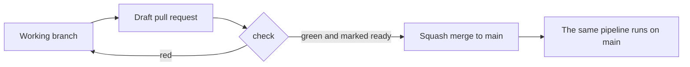

# How platform reaches production

Nothing in this repo reaches production yet. Production is built in phase 3, and this page grows with it. Today it says what will leave this repo, how a change reaches `main`, and which settings on GitHub protect that path.

## What will leave this repo

| What                                                 | How it will travel                                                                            | State on 2026-11-22 |
| ---------------------------------------------------- | --------------------------------------------------------------------------------------------- | ------------------- |
| The shared services for the laptop                   | Published to the public npm registry as the package `@zigordev/stack`, which a product starts | Not yet. Phase 2    |
| Changes to AWS, Cloudflare, GitHub and Grafana Cloud | The pipeline shows the plan in the pull request, and applies it after the owner's approval    | Not yet. Phase 3    |
| The shared services on the host                      | The host runs the same compose files as the laptop                                            | Not yet. Phase 3    |
| The dashboards and the alert rules                   | The pipeline pushes the same files to Grafana Cloud that the laptop pushes to its own Grafana | Not yet. Phase 3    |

## The path of a change

The pipeline is not written here. `.github/workflows/ci.yml` calls the one that `toolkit` holds, at one pinned commit, so this repo is checked exactly as every other repo is. It has four jobs, and one gate that passes only when all of them passed:

| Job          | What it checks                                                         | Runs on                            |
| ------------ | ---------------------------------------------------------------------- | ---------------------------------- |
| Quality      | `pnpm check`, exactly as on a laptop                                   | Every pull request and every merge |
| Title        | The pull request's title is a Conventional Commit                      | Pull requests                      |
| Dependencies | No dependency the pull request adds has a known flaw                   | Pull requests                      |
| Code scan    | CodeQL finds no vulnerable pattern in our own code or in the workflows | Every pull request and every merge |
| `check`      | Every job above passed                                                 | Every pull request and every merge |

A pull request opens as a draft. Marking it ready means: merge it when `check` is green. Nobody merges by hand. A change to infrastructure will be the exception: its plan waits for the owner's approval before anything is applied.

Renovate proposes each new version of the pipeline, as it does for any pinned action.

## The settings on GitHub

They were set by hand when the repo was created, on 2026-11-22, as a copy of the settings of `toolkit`. From phase 3 they are code in this repo.

| Setting                                | Value                                                                                                                 | Why                                                                                                          |
| -------------------------------------- | --------------------------------------------------------------------------------------------------------------------- | ------------------------------------------------------------------------------------------------------------ |
| Visibility                             | Public                                                                                                                | It keeps the pipeline, the code scan and the dependency checks free                                          |
| Merging                                | Squash only, with the pull request's title and description as the commit                                              | One commit per change on `main`, in one format                                                               |
| Branches                               | Deleted after a merge                                                                                                 | No stale branches                                                                                            |
| Ruleset on `main`                      | A pull request is required, `check` is required, no force push, no deletion, linear history, and nobody can bypass it | Nothing reaches `main` unchecked                                                                             |
| Dependency graph and Dependabot alerts | On                                                                                                                    | Dependency Review needs the graph, and the alerts tell the owner about a flaw in a dependency already in use |
| Secret scanning with push protection   | On                                                                                                                    | A push that holds a known kind of secret is refused                                                          |
| The token a workflow gets              | Read-only                                                                                                             | A job asks for each right it needs                                                                           |

## Looking after it

| Situation                                          | What to do                                                                                                                                          |
| -------------------------------------------------- | --------------------------------------------------------------------------------------------------------------------------------------------------- |
| `main` is red                                      | Fix it or revert the change before any other work. The run is under Actions, in the workflow named CI                                               |
| A pull request's Quality job is red                | `pnpm check` on the branch shows the same failure                                                                                                   |
| Its Title job is red                               | Rewrite the title as `type(scope): summary`, in lower case, with no final period                                                                    |
| Its Dependencies job is red                        | The job's summary names the dependency and its flaw. Take a fixed version, or do without it                                                         |
| Its Code scan job is red                           | The job's log lists each open finding with a link. Fix the code                                                                                     |
| The pipeline does not start at all                 | The caller names a commit of `toolkit` that does not hold the pipeline. Put the commit of a released version back, with its version beside it       |
| A pull request from Renovate is red, or stays open | [Dependency updates](https://github.com/zigordev/toolkit/blob/main/docs/handbook/dependency-updates.md), in the handbook, says what each case means |
| A change has to be undone                          | Revert it through a pull request                                                                                                                    |
