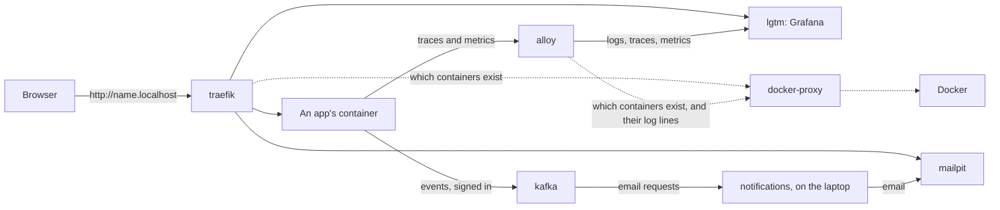

# @zigordev/stack

The shared services of the zigordev platform for a laptop: the ingress, the telemetry agent, the Kafka broker, a local Grafana and a mail catcher. They are two compose files, the standard dashboards and alert rules, and one command that starts it all.

## What it is

Six containers that every product on the laptop shares, and on the laptop the notifications service with its database. Four of them run in production too, from the same file.

| Service                     | Image                         | What it does                                                                                                                                                                              | Runs                                    |
| --------------------------- | ----------------------------- | ----------------------------------------------------------------------------------------------------------------------------------------------------------------------------------------- | --------------------------------------- |
| `traefik`                   | Traefik 3.7                   | The ingress. It sends each address to its container, from the labels that the container carries                                                                                           | Everywhere                              |
| `docker-proxy`              | wollomatic/socket-proxy 1.14  | A filtered door to Docker. It lets the ingress and the agent read which containers exist, and nothing else                                                                                | Everywhere                              |
| `alloy`                     | Grafana Alloy 1.22            | The telemetry agent. It receives traces and metrics from every app, reads every container's log lines and the machine's own numbers, and forwards all of it                               | Everywhere                              |
| `kafka`                     | Apache Kafka 4.4              | The broker for events between services: one node that is broker and controller at once. Every client signs in with SCRAM-SHA-512 as a user of its own, and may do only what a rule allows | Everywhere                              |
| `kafka-setup`               | Apache Kafka 4.4              | Not a service but a job: it adds Kafka's topics, users and rules from the list `KAFKA_SETUP`, and ends. It never deletes anything                                                         | Everywhere, after the broker is healthy |
| `lgtm`                      | grafana/otel-lgtm 0.41        | The local Grafana, with its stores for logs, traces and metrics in the same container                                                                                                     | Laptop only                             |
| `mailpit`                   | Mailpit 1.34                  | The mail catcher. It receives every email an app sends on the laptop, and shows it on a page                                                                                              | Laptop only                             |
| `gcx`                       | Grafana gcx 1.8               | Not a service but a job: it pushes the dashboards and the alert rules to the local Grafana, and ends                                                                                      | Laptop only, on each `up`               |
| `notifications-api`         | notifications, its tag `main` | The email service of every product. It reads each app's email requests from Kafka and sends the email to Mailpit                                                                          | Laptop only, started last by `up`       |
| `notifications-api-migrate` | notifications, its tag `main` | Not a service but a job: it sets up notifications' database, and ends                                                                                                                     | Laptop only, before the service         |
| `notifications-postgres`    | PostgreSQL 18                 | notifications' own database, on a network of its own                                                                                                                                      | Laptop only                             |

| File                 | What it holds                                                                                                                                                                         |
| -------------------- | ------------------------------------------------------------------------------------------------------------------------------------------------------------------------------------- |
| `compose.yaml`       | The four services that run everywhere, with the agent's config inside, and Kafka's job with its list of topics, users and rules                                                       |
| `compose.local.yaml` | What only the laptop has: the two other services, notifications with its job and its database, the local addresses, the published ports, the settings and Kafka's throwaway passwords |
| `observability/`     | The dashboards and the alert rules as files, which `pnpm build` writes from the code in the repo's `observability/` folder                                                            |
| `bin/` and `src/`    | The command `zigordev-stack`, which starts and stops them                                                                                                                             |



## Why we have it, and what we would lose without it

Every product needs an ingress, somewhere to send its telemetry and somewhere to send its mail. Without this package each product would bring its own, and two products could not run side by side on one laptop: both would want port 80, and their logs would land in two places.

Because the same four services run in production from the same file, a route or a log line that works on the laptop works there too. What differs is a short list of settings, and it is written down below.

Without the Docker proxy, the ingress and the agent would hold Docker's socket itself, which is the right to start any container with any privilege. A flaw in either would then be a flaw in the whole machine.

## How it works here, on the laptop and in production

### One project, one network, fixed names

The six containers form one Compose project named `platform`, whichever folder the files are started from. A product starts the same project from its own copy of this package, so a second start changes nothing, and two products share one set of services.

| Name              | What it is                                                                                                                                           |
| ----------------- | ---------------------------------------------------------------------------------------------------------------------------------------------------- |
| `zigordev`        | The network that every app joins. On it, the services answer to their own names                                                                      |
| `alloy:4318`      | Where an app sends its traces and metrics, over OTLP on HTTP. Port 4317 takes the same over gRPC                                                     |
| `127.0.0.1:4318`  | The same port, published on the laptop itself, for an app that runs as a process outside a container, such as one started with `pnpm dev`. HTTP only |
| `kafka:9092`      | Where an app in a container reaches Kafka, signed in with SCRAM-SHA-512 as its own user                                                              |
| `localhost:9094`  | The same broker, published on the laptop itself, for an app that runs as a process outside a container                                               |
| `mailpit:1025`    | Where an app sends its mail on the laptop, over SMTP                                                                                                 |
| `zigordev-docker` | A second network with no way out. Only the Docker proxy, the ingress and the agent are on it                                                         |

Nothing in the files points at a file on disk. That is on purpose: Compose recreates a container when the path of a mounted file changes, and each product has this package in a folder of its own. So the ingress and the proxy take their settings as variables and flags, and the agent's config travels inside `compose.yaml`, as the variable `ALLOY_CONFIG`. One line of shell writes it to a file in memory before Alloy starts, and Alloy then replaces that shell. A change to the config therefore recreates the agent and nothing else.

### What an app does to be served

An app joins the network and says three things about itself, in its own compose file:

| The app says                       | With                                                     | What it gets                                            |
| ---------------------------------- | -------------------------------------------------------- | ------------------------------------------------------- |
| "Route this address to me"         | The labels `traefik.enable`, a router rule and its port  | Requests for that address, once its health check passes |
| "This is my name"                  | Its service name in Compose, which is `<product>-<part>` | Its log lines in Grafana under that name, with no setup |
| "Send my traces and metrics there" | `OTEL_EXPORTER_OTLP_ENDPOINT: http://alloy:4318`         | Its traces and metrics in Grafana                       |

The ingress routes only to a container that asked for it and whose health check passes. A container that is still starting, or that turned unhealthy, gets no request.

The agent reads the log lines of every container on the two networks, through the proxy, and of no other container on the machine. When a line is JSON and carries a `traceId`, the agent stores that id beside the line. In Grafana the line then has a link named Trace, which opens the whole request, and a trace lists its own log lines. It looks for new containers every 5 seconds, so a job that runs for a few seconds is not missed.

### What the agent reports by itself

| What                                                             | From                                                           | Kept                                                                   |
| ---------------------------------------------------------------- | -------------------------------------------------------------- | ---------------------------------------------------------------------- |
| Its own heartbeat, under the name `alloy`                        | Itself                                                         | One series. An alert fires when it has been missing for 10 minutes     |
| The machine's processor, memory and disks, under the name `host` | Three read-only mounts of the machine: `/proc`, `/sys` and `/` | Only the series that a dashboard or an alert uses, and only real disks |
| Whether the Kafka broker answers, under the name `kafka`         | A connection to `kafka:9092` once a minute, with no sign-in    | One series. An alert fires when it has failed for 5 minutes            |

The three mounts let the agent read the machine's numbers. It runs as a user that is not root, so it reads only what every user of the machine may read. On the laptop "the machine" is the small Linux machine inside Docker Desktop.

The check of the broker only opens a connection. Alloy's own Kafka exporter would sign in at the agent's start, and on 2026-11-25 it stopped the whole agent whenever Kafka was down then, so it is not used. How far behind a consumer is, and the messages it set aside, come from each app's own numbers instead, which `@zigordev/events` reports.

### Dashboards and alert rules

`zigordev-stack up` ends by pushing twelve files to the local Grafana, with gcx: one folder, two dashboards and nine alert rules. A second push changes nothing.

| In Grafana                              | What it shows                                                                                                                                                                                     |
| --------------------------------------- | ------------------------------------------------------------------------------------------------------------------------------------------------------------------------------------------------- |
| Dashboards, folder `zigordev`, App      | One app, picked from a list: whether it reports, its version, its requests, the share that fail, its response times, its events, its errors, and its messages waiting and set aside               |
| Dashboards, folder `zigordev`, Platform | The machine's processor, memory and disks, the requests at the ingress, who is reporting, how old each product's newest dump and last good restore test are, and whether the Kafka broker answers |
| Alerting, nine rules                    | [The runbooks](../docs/runbooks/README.md) list them. On the laptop they show in Grafana and notify nobody                                                                                        |

A new app needs no entry anywhere. It appears in the list of the App dashboard with its first request, and every rule covers it.

### Each container is boxed in

| Rule                                                                                                                            | Why                                                                                           |
| ------------------------------------------------------------------------------------------------------------------------------- | --------------------------------------------------------------------------------------------- |
| An exact image version and its digest                                                                                           | The same bytes everywhere, and a tag pushed again changes nothing. Renovate proposes the next |
| A health check                                                                                                                  | `up` can wait for it, and the ingress can trust it                                            |
| A restart unless it was stopped                                                                                                 | The host restarts at night for updates, and every service comes back by itself                |
| A memory limit and a CPU limit                                                                                                  | One service cannot starve the others                                                          |
| An init process, no new privileges, no capabilities, at most 30 seconds to stop                                                 | A broken service stays inside its box and stops cleanly                                       |
| A user that is not root, and a read-only file system                                                                            | A flaw in the service cannot change the service                                               |
| No published port, except port 80 of the ingress, port 4318 of the agent and port 9094 of the broker, all on this laptop itself | Nothing is reachable from the network the laptop is on                                        |

`src/compose.test.ts` holds every service to these rules, one by one, and the jobs `gcx` and `kafka-setup` to all but the health check, which a job that ends does not need. The broker keeps a read-only root by writing only to its data volume and to two folders in memory: the settings its image writes at each start, and `/tmp`. `lgtm` is the one exception to the last-but-one row: it is six programs in one container, which start as root and write to their own folders. It runs on the laptop only.

| Service        | Memory limit | CPU limit | Used when idle on 2026-11-22               |
| -------------- | ------------ | --------- | ------------------------------------------ |
| `traefik`      | 128 MiB      | 1         | 24 MiB                                     |
| `docker-proxy` | 64 MiB       | 0.25      | 11 MiB                                     |
| `alloy`        | 256 MiB      | 1         | 51 MiB                                     |
| `lgtm`         | 2 GiB        | 2         | 614 MiB                                    |
| `mailpit`      | 128 MiB      | 0.5       | 10 MiB                                     |
| `kafka`        | 1 GiB        | 1         | 397 MiB on 2026-11-25, with a 512 MiB heap |
| `cloudflared`  | 128 MiB      | 0.5       | Not measured yet, production only          |

### The Docker proxy

The proxy refuses everything it was not told to allow. It answers only the ingress and the agent, and only these requests: `GET` on the version, the list of containers, one container, its log lines, the events and the networks, and `HEAD` on the ping. No request that starts, stops or changes anything gets through. It runs as a user that is not root, in the group that owns Docker's socket. On Docker Desktop that is group 0. Elsewhere the variable `DOCKER_SOCKET_GROUP` names it, as the pipeline does on its own machine.

### The ingress

Traefik takes all its settings from variables, so its own health check reads the same settings. Three choices are worth knowing:

| Choice                                                   | Why                                                                                                                       |
| -------------------------------------------------------- | ------------------------------------------------------------------------------------------------------------------------- |
| A header whose name only imitates another one is dropped | `X_Forwarded_For` is not `X-Forwarded-For`, but some servers read both as the same. Dropping it means nobody can fake one |
| No access log                                            | Traefik reports its request numbers as metrics. A line per request would carry addresses and paths into the logs          |
| It calls nobody                                          | The check for a new version and the usage report are off                                                                  |

Traefik warns once at each start that it "can reject some encoded characters in the request path". That is a notice about a setting we leave as it is.

### The broker

Kafka carries the events that one service sends to another. It is one node, broker and controller at once, so it keeps one copy of each message. Its data sits in the volume `kafka-data`, which in production is on the data disk, inside the disk's daily snapshot.

Every client signs in with SCRAM-SHA-512 as a user of its own, and may do only what a rule allows. A user without a rule can do nothing, and writing to a topic never makes it. So a typo in a topic's name fails at once, instead of making a second topic.

The list `KAFKA_SETUP`, in the settings of the job `kafka-setup` in `compose.yaml`, holds every topic, user and rule, one per line. The job runs once the broker is healthy, signs in as the user `setup`, adds what is missing, and ends. It never deletes: a line that goes leaves its topic, user or rule on the broker, because a topic holds data.

| Line                                    | What it adds                                                                                                                                           |
| --------------------------------------- | ------------------------------------------------------------------------------------------------------------------------------------------------------ |
| `topic <name> <partitions>`             | A topic with that many partitions, and one copy of each message                                                                                        |
| `user <name>`                           | A user. Its password comes from the job's variable `KAFKA_PASSWORD_<NAME>`, the name in capitals with `-` as `_`, and the job stops when it is not set |
| `allow <user> <operation> topic <name>` | A rule: the user may do the operation, such as `Read`, `Write` or `Describe`, on that topic                                                            |
| `allow <user> <operation> group <name>` | The same for a consumer group, which a reader needs too                                                                                                |
| Either `allow` line, ending `prefixed`  | The rule covers every name that starts with `<name>`                                                                                                   |

For example, an app `notes-api` that sends to `notes.requests`, reads it in the group `notes-api.counts`, and sets failed messages aside, as `@zigordev/events` does, needs these lines:

```yaml
KAFKA_SETUP: |
  topic notes.requests 3
  topic notes.requests.dead-letter 1
  user notes-api
  allow notes-api Write topic notes.requests
  allow notes-api Read topic notes.requests
  allow notes-api Write topic notes.requests.dead-letter
  allow notes-api Read group notes-api. prefixed
```

On the laptop the job also needs `KAFKA_PASSWORD_NOTES_API`, a throwaway password in `compose.local.yaml`. The app reaches the broker with three settings, which `@zigordev/events` reads: `KAFKA_BROKERS: kafka:9092`, `KAFKA_USERNAME: notes-api` and `KAFKA_PASSWORD`, the same password. In production an app's password lives once, at its own `/<product>/KAFKA_PASSWORD` in Parameter Store. A line of `.env.production.example` names it, such as `KAFKA_PASSWORD_NOTIFICATIONS_API=/notifications/KAFKA_PASSWORD`, and the host's deploy reads it from there. [Record 0028](../docs/adr/0028-the-shared-services-read-each-apps-kafka-password-from-the-apps-own-parameter.md) says why.

`KAFKA_SETUP` holds two users today. `notifications-api`, the notifications service, reads every app's requests and writes every app's answers, through three prefixed rules that never change when an app joins. `playground-api`, the playground's API, writes its email requests, reads their answers in its own groups, and sets a bad answer aside, through four rules of its own. On the laptop their passwords are `local-only-notifications-api` and `local-only-playground-api`, and in production the playground's lives at `/playground/KAFKA_PASSWORD`.

`KAFKA_SETUP` also holds the four topics of every app that sends email, the template's and the playground's too, and the service's right to set a bad request aside on each app's requests' dead-letter topic. The notifications service reads the requests topic of every app in its producer list, which ships in its image, wherever it runs. One missing topic stops it reading any, so every producer's topics exist on every broker.

On the laptop the job reads a second list after `KAFKA_SETUP`: `KAFKA_SETUP_LAPTOP`, in `compose.local.yaml`, for users that only a laptop needs. Production never sets it. It holds one user today, `template-api`, the product template's API, which sends its emails through the notifications service and never deploys. Its topics are in `KAFKA_SETUP`, so in production nobody can write to them. Its throwaway password is `local-only-template-api`.

The broker formats its own storage before the image starts it, and makes the users `admin` and `setup` there, because image 4.4.0 ignores the setting that would do that. [Record 0027](../docs/adr/0027-the-broker-formats-its-own-storage-and-one-list-holds-its-topics-users-and-rules.md) says why.

### notifications on the laptop

Every product's email requests travel over Kafka to the notifications service, which sends the email. So that one command brings everything up, the laptop also runs notifications, from the profile `notifications` in `compose.local.yaml`: the service, its migration job and its own PostgreSQL. It sends every email to Mailpit. In production notifications is a deploy target of its own, from its own repo.

- `zigordev-stack up` starts it last, after Kafka's job has made the topics and users, because a consumer that finds a topic missing never starts.
- It runs notifications' newest image: its tag `main`, pinned with the digest. Each merge to notifications' `main` moves the tag, and Renovate then proposes the new digest here, after the day's wait, as for every other image. toolkit's record 0052 says why. Its health check names the version `main`.
- It asks Traefik for no route, and its database publishes no port. It signs in to Kafka as `notifications-api`, with the throwaway password that Kafka's job gives that user.
- Work on notifications itself runs its own copy, from its repo. `zigordev-stack up --without notifications` stops the shared copy instead of starting it, so the two copies never share the requests.
- It holds at most 640 MB of memory: 256 MB for the service, 128 MB for the job while it runs, and 256 MB for the database.

### The laptop and production

The host starts `compose.yaml` with `compose.production.yaml`, through the deploy path of platform: every merge to `main` deploys them as the target `platform`. `docs/cloud-first-deploy.md` in platform says how.

| Thing                                        | On the laptop                                                                     | In production                                                                                                                                                                                                                |
| -------------------------------------------- | --------------------------------------------------------------------------------- | ---------------------------------------------------------------------------------------------------------------------------------------------------------------------------------------------------------------------------- |
| The four shared services                     | From `compose.yaml`                                                               | The same file                                                                                                                                                                                                                |
| How a request arrives                        | Port 80 on the laptop itself, over IPv4 and IPv6                                  | Through Cloudflare's tunnel. `cloudflared`, its connector, runs in production only and hands each request to the ingress                                                                                                     |
| How an app outside a container reports       | To `127.0.0.1:4318`, the agent's port published on the laptop itself              | Every app runs in a container, so the port is not published                                                                                                                                                                  |
| How an app outside a container reaches Kafka | `localhost:9094`, a listener published on the laptop itself                       | Every app runs in a container, so there is no such listener                                                                                                                                                                  |
| Kafka's passwords                            | Throwaway ones in `compose.local.yaml`                                            | The host's secrets `KAFKA_ADMIN_PASSWORD` and `KAFKA_SETUP_PASSWORD`, which `.env.production.example` names                                                                                                                  |
| Kafka's topics, users and rules              | `zigordev-stack up` runs the job `kafka-setup` after the health checks            | The deploy runs the job after the broker is healthy, as it runs a product's migrate job                                                                                                                                      |
| Where the agent sends                        | To `lgtm`, with a made-up name and password that nothing checks                   | To Grafana Cloud, with the secrets that `.env.production.example` names. Traces and metrics go to `${GRAFANA_OTLP_URL}/otlp`, and logs to `${GRAFANA_LOKI_URL}/loki/api/v1/push`, because the stored addresses carry no path |
| Each container's memory                      | No file, so the agent reads none                                                  | The host's file `/var/lib/platform/metrics/containers.prom`, which a timer writes every minute                                                                                                                               |
| The backups' results                         | No file, so the agent reads none                                                  | The host's files `/var/lib/platform/metrics/backup-dump.prom` and `backup-restore-test.prom`, which the backup script writes after each run                                                                                  |
| Grafana and the mail catcher                 | `lgtm` and `mailpit`                                                              | Grafana Cloud and Amazon SES                                                                                                                                                                                                 |
| The notifications service                    | A copy from the profile `notifications`, started last by `up`, sending to Mailpit | Its own deploy target, `notifications`, from its own repo, sending through Amazon SES                                                                                                                                        |
| The ingress's own pages                      | At `traefik.localhost`                                                            | Off                                                                                                                                                                                                                          |
| The proxy's group                            | 0, which owns the socket on Docker Desktop                                        | The group that owns the socket on the host, which the deploy passes as `DOCKER_SOCKET_GROUP`                                                                                                                                 |

## How to use it, with one worked example

In this repo:

```bash
pnpm local:up
pnpm local:down
pnpm local:reset
```

`local:up` builds the dashboard files, starts the services and waits until each one is healthy. It then sets up Kafka's topics, users and rules, pushes the dashboards and the alert rules, starts notifications, and prints the four addresses. `local:down` stops them and keeps their data. `local:reset` stops them, deletes their data and starts them again.

| Address                    | What opens                                                            |
| -------------------------- | --------------------------------------------------------------------- |
| `http://grafana.localhost` | Grafana. Explore searches every log line, trace and metric            |
| `http://mail.localhost`    | Mailpit, with every email that was sent on this laptop                |
| `http://traefik.localhost` | Traefik's own pages: the routes it knows, and why one is missing      |
| `http://alloy.localhost`   | Alloy's own pages: each part of its config, and whether it is healthy |

The worked example is an app named `playground-api`, of a product named `playground`. This is everything its compose file needs for the platform to serve it:

```yaml
services:
  playground-api:
    image: ghcr.io/zigordev/playground-api:1f3a9c2
    environment:
      PORT: "3000"
      OTEL_SERVICE_NAME: playground-api
      OTEL_EXPORTER_OTLP_ENDPOINT: http://alloy:4318
    healthcheck:
      test: [CMD, node, healthcheck.js]
    labels:
      traefik.enable: "true"
      traefik.http.routers.playground-api.rule: Host(`playground.localhost`) && PathPrefix(`/api`)
      traefik.http.services.playground-api.loadbalancer.server.port: "3000"
    networks: [zigordev]

networks:
  zigordev:
    external: true
```

With the shared services running, `http://playground.localhost/api/…` reaches the app as soon as its health check passes. Its log lines show in Grafana under `playground-api`, and so do its traces and metrics.

### From another repo

A product needs no copy of this repo. It takes this package from the public npm registry, as a dev dependency, and starts the same services with the command the package brings:

```bash
pnpm add --save-dev @zigordev/stack
pnpm exec zigordev-stack up
```

| Command                                     | What it does                                                                                                                                                                                                  |
| ------------------------------------------- | ------------------------------------------------------------------------------------------------------------------------------------------------------------------------------------------------------------- |
| `zigordev-stack up`                         | Starts the services, waits until each one is healthy, sets up Kafka's topics, users and rules, pushes the dashboards and the alert rules, and starts notifications. When they run already, it changes nothing |
| `zigordev-stack up --without notifications` | The same, but it stops the shared copy of notifications instead of starting it. notifications' own repo starts with it                                                                                        |
| `zigordev-stack down`                       | Stops them and keeps their data                                                                                                                                                                               |
| `zigordev-stack reset`                      | Stops them, deletes their data and starts them again                                                                                                                                                          |

The package holds the two compose files, the dashboard and alert files already built, and the command. It has no dependency of its own. It needs Node.js 26 or later, and Docker running.

The product template in `toolkit` begins its own `pnpm local:up` with `zigordev-stack up`, so one command brings up the platform and then the product.

Every product starts the same project, named `platform`. Two products that hold the same version of this package therefore share one set of services, and the second start changes nothing. With two different versions, each start recreates the services that differ, so the laptop runs what was started last. Renovate proposes each new version to every product at once, which keeps them together.

## How to check that it works, and what to do when it does not

| Try this                                                                          | What must happen                                                                                                                                                   |
| --------------------------------------------------------------------------------- | ------------------------------------------------------------------------------------------------------------------------------------------------------------------ |
| `pnpm local:up`                                                                   | It prints "kafka-setup: done", and ends with "The shared services are up:" and the four addresses                                                                  |
| `pnpm local:up` a second time                                                     | The same, within seconds, and no service is recreated                                                                                                              |
| Open `http://grafana.localhost`, then Dashboards, then the folder `zigordev`      | The dashboards App and Platform are there, and Platform shows the machine's numbers                                                                                |
| In Grafana, open Alerting, then Alert rules                                       | Nine rules are listed in the folder `zigordev`, each one "Normal"                                                                                                  |
| Open `http://grafana.localhost` and `http://mail.localhost`                       | Both pages open, with no sign-in                                                                                                                                   |
| In Grafana's Explore, pick Loki and run `{service_name="traefik"}`                | Traefik's own log lines show                                                                                                                                       |
| Open `http://nothing.localhost`                                                   | Traefik answers 404, because no container asked for that address                                                                                                   |
| `pnpm exec vitest run stack`                                                      | Every rule on this page that a machine can check passes                                                                                                            |
| `docker exec platform-notifications-api-1 wget -qO- http://127.0.0.1:3000/health` | `"status":"ok"`, with `db`, `provider` and `kafka` each `up`                                                                                                       |
| Open a pull request                                                               | The job "Shared services" starts all six and notifications on GitHub's machine, opens the four addresses and stops them. A change that breaks a start cannot merge |

| What you see                                                                    | What it means                                                                                                                                                        | What to do                                                                                                                                            |
| ------------------------------------------------------------------------------- | -------------------------------------------------------------------------------------------------------------------------------------------------------------------- | ----------------------------------------------------------------------------------------------------------------------------------------------------- |
| `Cannot connect to the Docker daemon`                                           | Docker is not running                                                                                                                                                | Start Docker Desktop                                                                                                                                  |
| `Bind for 127.0.0.1:80 failed: port is already allocated`                       | Another program on the laptop holds port 80                                                                                                                          | Find it with `lsof -nP -iTCP:80 -sTCP:LISTEN`, and stop it                                                                                            |
| `Bind for 127.0.0.1:4318 failed: port is already allocated`                     | Another program on the laptop holds port 4318, often another OpenTelemetry collector                                                                                 | Find it with `lsof -nP -iTCP:4318 -sTCP:LISTEN`, and stop it                                                                                          |
| `Bind for 127.0.0.1:9094 failed: port is already allocated`                     | Another program on the laptop holds port 9094, often another Kafka                                                                                                   | Find it with `lsof -nP -iTCP:9094 -sTCP:LISTEN`, and stop it                                                                                          |
| `local:up` says Kafka's topics and users could not be set up                    | The job `kafka-setup` could not sign in, or a line of `KAFKA_SETUP` is wrong, or a user's password is not set                                                        | The line above "zigordev-stack:" starts with "kafka-setup:" and says which. Each line takes one of the three forms of record 0027                     |
| `local:up` ends with "not every shared service became healthy"                  | One container did not pass its health check in 5 minutes                                                                                                             | The lines above name it. `docker logs platform-<service>-1` shows why                                                                                 |
| `local:up` says notifications did not become healthy                            | Its database, its migration job or the service itself failed. A topic or a Kafka user that is missing from `KAFKA_SETUP` stops its consumer                          | `docker logs platform-notifications-api-1`, or `platform-notifications-api-migrate-1` for the job, shows why                                          |
| `zigordev-stack up` says "the dashboard files are missing"                      | The files in `stack/observability/` are built, not committed                                                                                                         | `pnpm build`, which `pnpm local:up` does by itself                                                                                                    |
| `local:up` says the dashboards and the alert rules could not be pushed          | gcx could not reach Grafana, or Grafana refused a file                                                                                                               | The lines above name the file and the reason. `pnpm exec vitest run observability` checks the files' shape                                            |
| A dashboard or a rule that was removed from the code is still in Grafana        | gcx does not delete what the files no longer hold                                                                                                                    | `pnpm local:reset` empties the local Grafana                                                                                                          |
| `docker-proxy` is unhealthy, and its log says `permission denied` on the socket | The proxy is not in the group that owns Docker's socket on this machine                                                                                              | Start with that group in `DOCKER_SOCKET_GROUP`. `stat -c %g /var/run/docker.sock` prints it on Linux. On Docker Desktop it is 0, which is the default |
| An app answers on its own port and Traefik answers 404 for its address          | The app is not on the network `zigordev`, has no `traefik.enable`, or is not healthy                                                                                 | `http://traefik.localhost` lists the routes Traefik knows. A container without a passing health check is not there                                    |
| An app's log lines do not show in Grafana                                       | The app is not on the network `zigordev`, so the agent does not read it                                                                                              | Add the network to the app's service                                                                                                                  |
| An app's traces do not show                                                     | The app sends them somewhere else, or nowhere                                                                                                                        | Set `OTEL_EXPORTER_OTLP_ENDPOINT` to `http://alloy:4318`. `http://alloy.localhost` shows what Alloy received                                          |
| The App dashboard lists a new app, and its request panels say "No data"         | The app has reported its request numbers once. A rate needs two reports, and an app reports once a minute, so the requests before its first report are never counted | Send a few more requests and wait a minute                                                                                                            |
| Grafana is slow, or `lgtm` restarts                                             | `lgtm` reached its memory limit                                                                                                                                      | `docker stats --no-stream` shows each container against its limit. `pnpm local:reset` empties the stores                                              |
