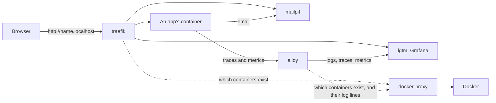

# @zigordev/stack

The shared services of the zigordev platform for a laptop: the ingress, the telemetry agent, a local Grafana and a mail catcher. They are two compose files, the standard dashboards and alert rules, and one command that starts it all.

## What it is

Five containers that every product on the laptop shares. Three of them run in production too, from the same file.

| Service        | Image                        | What it does                                                                                                                                                | Runs                      |
| -------------- | ---------------------------- | ----------------------------------------------------------------------------------------------------------------------------------------------------------- | ------------------------- |
| `traefik`      | Traefik 3.7                  | The ingress. It sends each address to its container, from the labels that the container carries                                                             | Everywhere                |
| `docker-proxy` | wollomatic/socket-proxy 1.14 | A filtered door to Docker. It lets the ingress and the agent read which containers exist, and nothing else                                                  | Everywhere                |
| `alloy`        | Grafana Alloy 1.22           | The telemetry agent. It receives traces and metrics from every app, reads every container's log lines and the machine's own numbers, and forwards all of it | Everywhere                |
| `lgtm`         | grafana/otel-lgtm 0.41       | The local Grafana, with its stores for logs, traces and metrics in the same container                                                                       | Laptop only               |
| `mailpit`      | Mailpit 1.34                 | The mail catcher. It receives every email an app sends on the laptop, and shows it on a page                                                                | Laptop only               |
| `gcx`          | Grafana gcx 1.8              | Not a service but a job: it pushes the dashboards and the alert rules to the local Grafana, and ends                                                        | Laptop only, on each `up` |

| File                 | What it holds                                                                                                              |
| -------------------- | -------------------------------------------------------------------------------------------------------------------------- |
| `compose.yaml`       | The three services that run everywhere, with the agent's config inside                                                     |
| `compose.local.yaml` | What only the laptop has: the two other services, the local addresses, the published port and the settings                 |
| `observability/`     | The dashboards and the alert rules as files, which `pnpm build` writes from the code in the repo's `observability/` folder |
| `bin/` and `src/`    | The command `zigordev-stack`, which starts and stops them                                                                  |



## Why we have it, and what we would lose without it

Every product needs an ingress, somewhere to send its telemetry and somewhere to send its mail. Without this package each product would bring its own, and two products could not run side by side on one laptop: both would want port 80, and their logs would land in two places.

Because the same three services run in production from the same file, a route or a log line that works on the laptop works there too. What differs is a short list of settings, and it is written down below.

Without the Docker proxy, the ingress and the agent would hold Docker's socket itself, which is the right to start any container with any privilege. A flaw in either would then be a flaw in the whole machine.

## How it works here, on the laptop and in production

### One project, one network, fixed names

The five containers form one Compose project named `platform`, whichever folder the files are started from. A product starts the same project from its own copy of this package, so a second start changes nothing, and two products share one set of services.

| Name              | What it is                                                                                       |
| ----------------- | ------------------------------------------------------------------------------------------------ |
| `zigordev`        | The network that every app joins. On it, the services answer to their own names                  |
| `alloy:4318`      | Where an app sends its traces and metrics, over OTLP on HTTP. Port 4317 takes the same over gRPC |
| `mailpit:1025`    | Where an app sends its mail on the laptop, over SMTP                                             |
| `zigordev-docker` | A second network with no way out. Only the Docker proxy, the ingress and the agent are on it     |

Nothing in the files points at a file on disk. That is on purpose: Compose recreates a container when the path of a mounted file changes, and each product has this package in a folder of its own. So the ingress and the proxy take their settings as variables and flags, and the agent's config travels inside `compose.yaml`, as the variable `ALLOY_CONFIG`. One line of shell writes it to a file in memory before Alloy starts, and Alloy then replaces that shell. A change to the config therefore recreates the agent and nothing else.

### What an app does to be served

An app joins the network and says three things about itself, in its own compose file:

| The app says                       | With                                                     | What it gets                                            |
| ---------------------------------- | -------------------------------------------------------- | ------------------------------------------------------- |
| "Route this address to me"         | The labels `traefik.enable`, a router rule and its port  | Requests for that address, once its health check passes |
| "This is my name"                  | Its service name in Compose, which is `<product>-<part>` | Its log lines in Grafana under that name, with no setup |
| "Send my traces and metrics there" | `OTEL_EXPORTER_OTLP_ENDPOINT: http://alloy:4318`         | Its traces and metrics in Grafana                       |

The ingress routes only to a container that asked for it and whose health check passes. A container that is still starting, or that turned unhealthy, gets no request.

The agent reads the log lines of every container on the two networks, through the proxy, and of no other container on the machine. When a line is JSON and carries a `traceId`, the agent stores that id beside the line. In Grafana the line then has a link named Trace, which opens the whole request, and a trace lists its own log lines. It looks for new containers every 5 seconds, so a job that runs for a few seconds is not missed.

### What the agent reports by itself

| What                                                             | From                                                           | Kept                                                                   |
| ---------------------------------------------------------------- | -------------------------------------------------------------- | ---------------------------------------------------------------------- |
| Its own heartbeat, under the name `alloy`                        | Itself                                                         | One series. An alert fires when it has been missing for 10 minutes     |
| The machine's processor, memory and disks, under the name `host` | Three read-only mounts of the machine: `/proc`, `/sys` and `/` | Only the series that a dashboard or an alert uses, and only real disks |

The three mounts let the agent read the machine's numbers. It runs as a user that is not root, so it reads only what every user of the machine may read. On the laptop "the machine" is the small Linux machine inside Docker Desktop.

### Dashboards and alert rules

`zigordev-stack up` ends by pushing seven files to the local Grafana, with gcx: one folder, two dashboards and four alert rules. A second push changes nothing.

| In Grafana                              | What it shows                                                                                                                                  |
| --------------------------------------- | ---------------------------------------------------------------------------------------------------------------------------------------------- |
| Dashboards, folder `zigordev`, App      | One app, picked from a list: whether it reports, its version, its requests, the share that fail, its response times, its events and its errors |
| Dashboards, folder `zigordev`, Platform | The machine's processor, memory and disks, the requests at the ingress, and who is reporting                                                   |
| Alerting, four rules                    | [The runbooks](../docs/runbooks/README.md) list them. On the laptop they show in Grafana and notify nobody                                     |

A new app needs no entry anywhere. It appears in the list of the App dashboard with its first request, and every rule covers it.

### Each container is boxed in

| Rule                                                                            | Why                                                            |
| ------------------------------------------------------------------------------- | -------------------------------------------------------------- |
| An exact image version                                                          | The same bytes on every laptop, and Renovate proposes the next |
| A health check                                                                  | `up` can wait for it, and the ingress can trust it             |
| A memory limit and a CPU limit                                                  | One service cannot starve the others                           |
| An init process, no new privileges, no capabilities, at most 30 seconds to stop | A broken service stays inside its box and stops cleanly        |
| A user that is not root, and a read-only file system                            | A flaw in the service cannot change the service                |
| No published port, except port 80 of the ingress, on this laptop itself         | Nothing is reachable from the network the laptop is on         |

`src/compose.test.ts` holds every service to these rules, one by one, and the job `gcx` to all but the health check, which a job that ends does not need. `lgtm` is the one exception to the last-but-one row: it is six programs in one container, which start as root and write to their own folders. It runs on the laptop only.

| Service        | Memory limit | CPU limit | Used when idle on 2026-11-22 |
| -------------- | ------------ | --------- | ---------------------------- |
| `traefik`      | 128 MiB      | 1         | 24 MiB                       |
| `docker-proxy` | 64 MiB       | 0.25      | 11 MiB                       |
| `alloy`        | 256 MiB      | 1         | 51 MiB                       |
| `lgtm`         | 2 GiB        | 2         | 614 MiB                      |
| `mailpit`      | 128 MiB      | 0.5       | 10 MiB                       |

### The Docker proxy

The proxy refuses everything it was not told to allow. It answers only the ingress and the agent, and only these requests: `GET` on the version, the list of containers, one container, its log lines, the events and the networks, and `HEAD` on the ping. No request that starts, stops or changes anything gets through. It runs as a user that is not root, in the group that owns Docker's socket. On Docker Desktop that is group 0. Elsewhere the variable `DOCKER_SOCKET_GROUP` names it, as the pipeline does on its own machine.

### The ingress

Traefik takes all its settings from variables, so its own health check reads the same settings. Three choices are worth knowing:

| Choice                                                   | Why                                                                                                                       |
| -------------------------------------------------------- | ------------------------------------------------------------------------------------------------------------------------- |
| A header whose name only imitates another one is dropped | `X_Forwarded_For` is not `X-Forwarded-For`, but some servers read both as the same. Dropping it means nobody can fake one |
| No access log                                            | Traefik reports its request numbers as metrics. A line per request would carry addresses and paths into the logs          |
| It calls nobody                                          | The check for a new version and the usage report are off                                                                  |

Traefik warns once at each start that it "can reject some encoded characters in the request path". That is a notice about a setting we leave as it is.

### The laptop and production

Production is built in phase 3. It will start `compose.yaml` with a `compose.production.yaml` of its own.

| Thing                        | On the laptop                                                   | In production                                       |
| ---------------------------- | --------------------------------------------------------------- | --------------------------------------------------- |
| The three shared services    | From `compose.yaml`                                             | The same file                                       |
| How a request arrives        | Port 80 on the laptop itself, over IPv4 and IPv6                | Through Cloudflare's tunnel, with no published port |
| Where the agent sends        | To `lgtm`, with a made-up name and password that nothing checks | To Grafana Cloud                                    |
| Grafana and the mail catcher | `lgtm` and `mailpit`                                            | Grafana Cloud and Amazon SES                        |
| The ingress's own pages      | At `traefik.localhost`                                          | Off                                                 |
| The proxy's group            | 0, which owns the socket on Docker Desktop                      | The group that owns the socket on the host          |

## How to use it, with one worked example

In this repo:

```bash
pnpm local:up
pnpm local:down
pnpm local:reset
```

`local:up` builds the dashboard files, starts the services and waits until each one is healthy. It then pushes the dashboards and the alert rules, and prints the four addresses. `local:down` stops them and keeps their data. `local:reset` stops them, deletes their data and starts them again.

| Address                    | What opens                                                            |
| -------------------------- | --------------------------------------------------------------------- |
| `http://grafana.localhost` | Grafana. Explore searches every log line, trace and metric            |
| `http://mail.localhost`    | Mailpit, with every email that was sent on this laptop                |
| `http://traefik.localhost` | Traefik's own pages: the routes it knows, and why one is missing      |
| `http://alloy.localhost`   | Alloy's own pages: each part of its config, and whether it is healthy |

The worked example is an app named `hello-api`, of a product named `hello`. This is everything its compose file needs for the platform to serve it:

```yaml
services:
  hello-api:
    image: ghcr.io/zigordev/hello-api:1f3a9c2
    environment:
      PORT: "3000"
      OTEL_SERVICE_NAME: hello-api
      OTEL_EXPORTER_OTLP_ENDPOINT: http://alloy:4318
    healthcheck:
      test: [CMD, node, healthcheck.js]
    labels:
      traefik.enable: "true"
      traefik.http.routers.hello-api.rule: Host(`hello.localhost`) && PathPrefix(`/api`)
      traefik.http.services.hello-api.loadbalancer.server.port: "3000"
    networks: [zigordev]

networks:
  zigordev:
    external: true
```

With the shared services running, `http://hello.localhost/api/…` reaches the app as soon as its health check passes. Its log lines show in Grafana under `hello-api`, and so do its traces and metrics.

Another repo will take this package from npm and start it with `zigordev-stack up`. It is not published yet.

## How to check that it works, and what to do when it does not

| Try this                                                                     | What must happen                                                                                                                                  |
| ---------------------------------------------------------------------------- | ------------------------------------------------------------------------------------------------------------------------------------------------- |
| `pnpm local:up`                                                              | It ends with "The shared services are up:" and the four addresses                                                                                 |
| `pnpm local:up` a second time                                                | The same, within seconds, and no container is recreated                                                                                           |
| Open `http://grafana.localhost`, then Dashboards, then the folder `zigordev` | The dashboards App and Platform are there, and Platform shows the machine's numbers                                                               |
| In Grafana, open Alerting, then Alert rules                                  | Four rules are listed in the folder `zigordev`, each one "Normal"                                                                                 |
| Open `http://grafana.localhost` and `http://mail.localhost`                  | Both pages open, with no sign-in                                                                                                                  |
| In Grafana's Explore, pick Loki and run `{service_name="traefik"}`           | Traefik's own log lines show                                                                                                                      |
| Open `http://nothing.localhost`                                              | Traefik answers 404, because no container asked for that address                                                                                  |
| `pnpm exec vitest run stack`                                                 | Every rule on this page that a machine can check passes                                                                                           |
| Open a pull request                                                          | The job "Shared services" starts all five on GitHub's machine, opens the four addresses and stops them. A change that breaks a start cannot merge |

| What you see                                                                    | What it means                                                                                                                                                        | What to do                                                                                                                                            |
| ------------------------------------------------------------------------------- | -------------------------------------------------------------------------------------------------------------------------------------------------------------------- | ----------------------------------------------------------------------------------------------------------------------------------------------------- |
| `Cannot connect to the Docker daemon`                                           | Docker is not running                                                                                                                                                | Start Docker Desktop                                                                                                                                  |
| `Bind for 127.0.0.1:80 failed: port is already allocated`                       | Another program on the laptop holds port 80                                                                                                                          | Find it with `lsof -nP -iTCP:80 -sTCP:LISTEN`, and stop it                                                                                            |
| `local:up` ends with "not every shared service became healthy"                  | One container did not pass its health check in 5 minutes                                                                                                             | The lines above name it. `docker logs platform-<service>-1` shows why                                                                                 |
| `zigordev-stack up` says "the dashboard files are missing"                      | The files in `stack/observability/` are built, not committed                                                                                                         | `pnpm build`, which `pnpm local:up` does by itself                                                                                                    |
| `local:up` says the dashboards and the alert rules could not be pushed          | gcx could not reach Grafana, or Grafana refused a file                                                                                                               | The lines above name the file and the reason. `pnpm exec vitest run observability` checks the files' shape                                            |
| A dashboard or a rule that was removed from the code is still in Grafana        | gcx does not delete what the files no longer hold                                                                                                                    | `pnpm local:reset` empties the local Grafana                                                                                                          |
| `docker-proxy` is unhealthy, and its log says `permission denied` on the socket | The proxy is not in the group that owns Docker's socket on this machine                                                                                              | Start with that group in `DOCKER_SOCKET_GROUP`. `stat -c %g /var/run/docker.sock` prints it on Linux. On Docker Desktop it is 0, which is the default |
| An app answers on its own port and Traefik answers 404 for its address          | The app is not on the network `zigordev`, has no `traefik.enable`, or is not healthy                                                                                 | `http://traefik.localhost` lists the routes Traefik knows. A container without a passing health check is not there                                    |
| An app's log lines do not show in Grafana                                       | The app is not on the network `zigordev`, so the agent does not read it                                                                                              | Add the network to the app's service                                                                                                                  |
| An app's traces do not show                                                     | The app sends them somewhere else, or nowhere                                                                                                                        | Set `OTEL_EXPORTER_OTLP_ENDPOINT` to `http://alloy:4318`. `http://alloy.localhost` shows what Alloy received                                          |
| The App dashboard lists a new app, and its request panels say "No data"         | The app has reported its request numbers once. A rate needs two reports, and an app reports once a minute, so the requests before its first report are never counted | Send a few more requests and wait a minute                                                                                                            |
| Grafana is slow, or `lgtm` restarts                                             | `lgtm` reached its memory limit                                                                                                                                      | `docker stats --no-stream` shows each container against its limit. `pnpm local:reset` empties the stores                                              |
